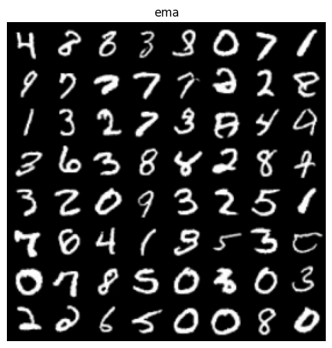
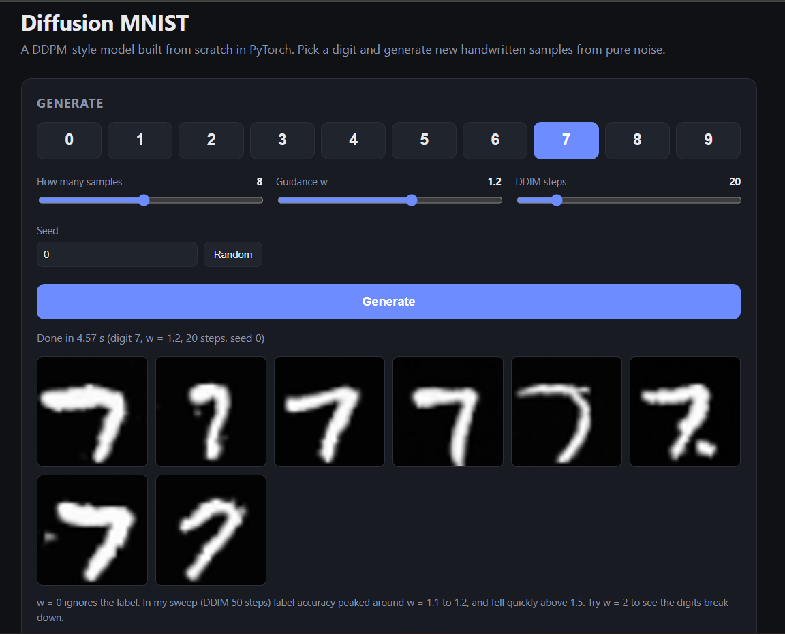
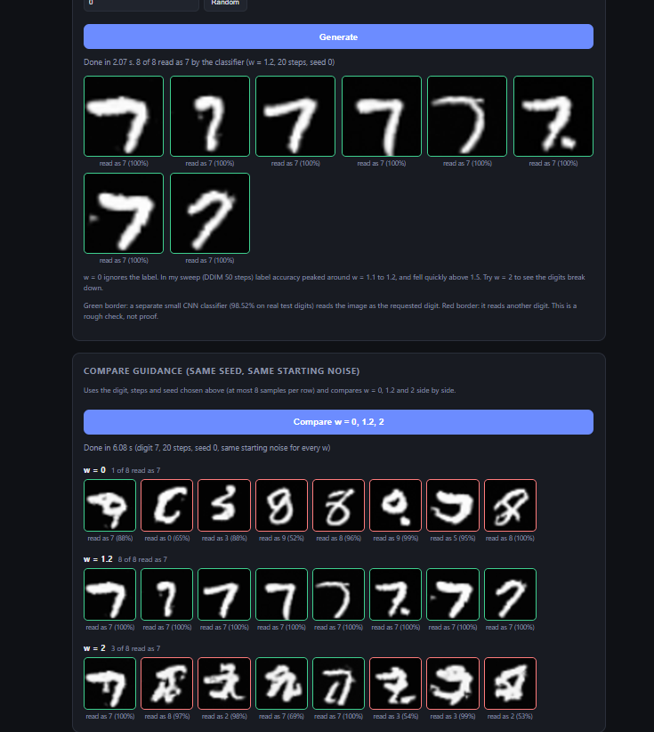
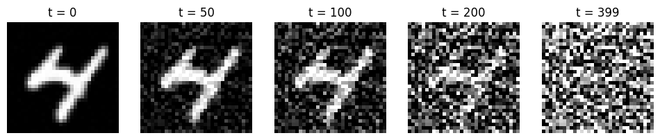
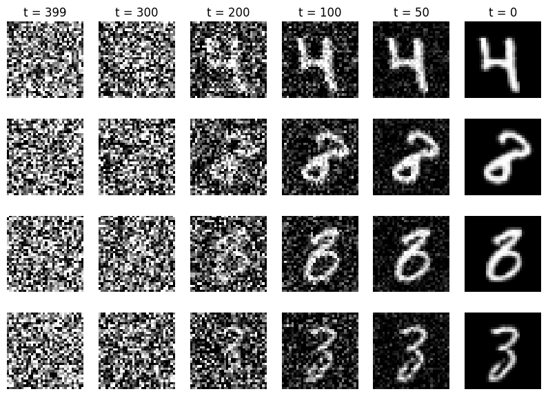
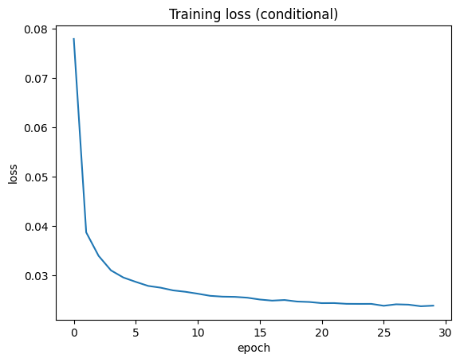
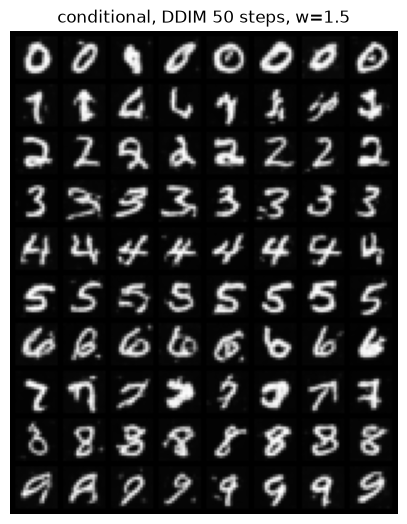
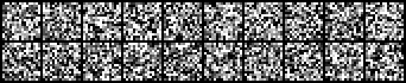
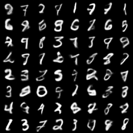

# Diffusion MNIST

A DDPM-style image generator built **from scratch in PyTorch**.
It learns to remove noise, then turns pure static into brand-new handwritten digits.

[](results/samples_ema.png)

I built this to understand the core idea behind Stable Diffusion and Midjourney, scaled down to MNIST. Everything (noise schedule, U-Net, training loop, samplers) is written by hand.

**Live demo:** [diffusion-mnist.vercel.app](https://diffusion-mnist.vercel.app/) (Next.js frontend on Vercel, FastAPI + PyTorch backend on Modal, CPU). The first request after a quiet period can be slow while the backend wakes up; I have not measured that start-up time.

**Features**

- U-Net with sinusoidal time embeddings
- 400-step linear noise schedule
- DDPM sampler (400 steps) and DDIM sampler (10 to 50 steps)
- EMA of weights
- Class-conditional generation with classifier-free guidance
- Classifier-based evaluation of generated digits
- Denoising GIF and a Gradio live demo
- Full-stack demo: FastAPI backend with a web interface
- **DiffusionLab:** Next.js frontend on Vercel with a serverless FastAPI inference backend on Modal
- VAE baseline, nearest-neighbour copy check and a per-digit diagnosis

**Final results use 32x32 images, trained on a free Colab T4 GPU.** Earlier 16x16 runs on a laptop CPU are kept as a side note at the end of the Results section.

---

## Table of contents

1. [How diffusion works](#how-diffusion-works)
2. [Setup](#setup)
3. [Usage](#usage)
4. [Full-stack demo](#full-stack-demo)
5. [Results](#results)
6. [Limits and what I do not claim](#limits-and-what-i-do-not-claim)
7. [What went wrong](#what-went-wrong)
8. [Project structure](#project-structure)
9. [References](#references)

---

## How diffusion works

A diffusion model learns to generate images by reversing the process of adding noise. During training, Gaussian noise is gradually added to real images over 400 steps until they become pure noise. A mathematical formula allows us to directly generate any noise level, making training more efficient. A U-Net is trained to predict and remove this noise, using time embeddings to understand each stage. During generation, the model starts with random noise and progressively removes it, transforming static into a completely new image.

The key formula (forward process, jump straight to step `t`):

```
x_t = sqrt(alpha_bar_t) * x_0 + sqrt(1 - alpha_bar_t) * eps,    eps ~ N(0, I)
```

Training objective (predict the noise):

```
L = || eps - eps_theta(x_t, t) ||^2
```

---

## Setup

```
python -m venv venv

# Windows PowerShell
venv\Scripts\Activate.ps1
# Mac / Linux
# source venv/bin/activate

# Install torch and torchvision first, using the command from pytorch.org
pip install -r requirements.txt
python check_setup.py
```

Tested with Python 3.13 and PyTorch 2.15 (CPU build).

**Image size.** `config.py` holds `IMG_SIZE` and `BASE_CH`. The final results use `IMG_SIZE = 32` and `BASE_CH = 64`. For a quick run on a laptop CPU, use `IMG_SIZE = 16` and `BASE_CH = 32`.

**Pretrained inference checkpoints are included in `checkpoints/`:** `cond_ema.pt` (conditional diffusion model) and `classifier.pt` (evaluation classifier). These are the two files used by the deployed `server2.py` inference API. To reproduce training from scratch, follow the training commands below; the 32x32 models took about 30 minutes each on a Colab T4.

Other local checkpoint files remain ignored by Git unless explicitly added.

---

## Usage

| Command                              | What it does                                                                                   |
| ------------------------------------ | ---------------------------------------------------------------------------------------------- |
| `python data.py`                     | Check the data pipeline and save a grid of real digits                                         |
| `python diffusion.py`                | Plot the forward process (digit turning into static)                                           |
| `python model.py`                    | Check U-Net shapes and that the output reacts to `t` and the label                             |
| `python train.py --overfit`          | Sanity check: overfit a single batch of 16 images                                              |
| `python train.py --epochs 30`        | Train the unconditional model                                                                  |
| `python train.py --cond --epochs 30` | Train the class-conditional model                                                              |
| `python sample.py`                   | Unconditional DDPM sampling (400 steps)                                                        |
| `python sample.py --ddim 50`         | Unconditional DDIM sampling (50 steps)                                                         |
| `python sample_cond.py --w 1.0`      | Conditional sampling, one digit per row                                                        |
| `python evaluate.py`                 | Classifier-based evaluation                                                                    |
| `python sweep_w.py`                  | Label accuracy for several guidance strengths                                                  |
| `python make_gif.py`                 | Denoising GIF (two rows of digits 0 to 9)                                                      |
| `python check_clf.py`                | Test accuracy of the saved classifier on real MNIST (98.52% at 32x32, see Results section 7)   |
| `python diagnose.py`                 | Per-digit diagnosis of unconditional and guided samples (about 15 to 18 min on a laptop CPU)   |
| `python app.py`                      | Gradio live demo (local only)                                                                  |
| `python app.py --share`              | Same demo with a temporary public `gradio.live` link, only while the app is running           |
| `python vae.py --epochs 10`          | Small VAE baseline, scored by the same classifier (about 40 s per epoch on a laptop CPU)       |
| `python guidance_seeds.py`           | Repeat the `w = 1.0` against `w = 1.2` comparison over 3 seeds (about 1 hour on a laptop CPU)  |
| `python plot_diagnose.py`            | Figures from `results/diagnose.json` (counts, per-digit accuracy, confusion matrices)         |
| `python nn_check.py`                 | Check whether generated digits are copies of training images (nearest-neighbour distance)     |
| `python preflight.py`                | Check files, packages and ports before a local demo                                            |
| `uvicorn server:app --port 8000`     | Full-stack demo (FastAPI backend + web page at [http://localhost:8000](http://localhost:8000)) |
| `uvicorn server2:app --port 8001`    | Second version of the web demo: classifier verdict under every digit and a guidance comparison  |
| `modal deploy modal_app.py`          | Deploy the FastAPI backend to Modal (needs a Modal account and the Modal CLI logged in)        |

All settings (image size, `T`, learning rate, epochs, EMA decay) live in `config.py`.

---

## Full-stack demo

A FastAPI backend loads the conditional model once and serves `POST /api/generate` (digit, count, guidance `w`, DDIM steps, seed). A single-page web interface in `static/index.html` calls it and shows the generated digits, the denoising GIF and the guidance sweep plot. Auto-generated API docs are at `/docs`.

The newer `server2.py` API also provides classifier verdicts, guidance comparison and evaluation endpoints. The deployed DiffusionLab frontend uses this version.

```
pip install -r requirements.txt
uvicorn server:app --port 8000
# open http://localhost:8000
```

[](results/web_demo.png)

A second version (`server2.py` with `static/index2.html`, run with `uvicorn server2:app --port 8001`) also runs the evaluation classifier on every generated digit (green border: it reads the requested digit, red: another digit) and has a "Compare guidance" button that generates `w = 0`, `1.2` and `2` from the same starting noise. The classifier verdict is a rough check, not proof.

[](results/web_demo2.png)

Needs `checkpoints/cond_ema.pt` and `checkpoints/classifier.pt`.

---

### DiffusionLab frontend (Next.js)

A Next.js interface (`frontend/`) for the same model: Studio (generate), guidance comparison, a local history of generations (stored in the browser, no database and no login), model insights and a small evaluation panel. Screenshots of the deployed app are in Results section 12.

**Live website:** [https://diffusion-mnist.vercel.app/](https://diffusion-mnist.vercel.app/)

The production frontend is hosted on Vercel. Its `NEXT_PUBLIC_API_URL` points to the Modal FastAPI endpoint:

`https://aaravka05--diffusionlab-api-fastapi-app.us-east.modal.run`

For local development, run the backend and frontend separately:

```
# terminal 1 (project folder, venv active)
python -m uvicorn server2:app --host 127.0.0.1 --port 8000

# terminal 2
cd frontend
npm install
npm run dev
# open http://localhost:3000
```

### Production deployment (Vercel + Modal)

The public website uses two services:

| Component | Platform | Purpose |
| --- | --- | --- |
| Next.js frontend | Vercel | Serves the user interface |
| FastAPI inference API | Modal | Loads trained checkpoints and runs generation/evaluation |

**Deploy the backend** from the project root, with the virtual environment active and Modal CLI authenticated:

```bash
modal deploy modal_app.py
```

Modal uploads the application code, required Python modules, static assets and `checkpoints/`, then prints the deployed web endpoint. The endpoint currently configured in the frontend is:

`https://aaravka05--diffusionlab-api-fastapi-app.us-east.modal.run`

The API provides:

- `GET /api/info` — backend status and model information
- `POST /api/generate` — class-conditional digit generation
- `POST /api/compare` — guidance comparison
- `POST /api/evaluate` — evaluation results

**Deploy the frontend** from the `frontend/` directory through Vercel. Set this environment variable for Preview and Production:

```env
NEXT_PUBLIC_API_URL=https://aaravka05--diffusionlab-api-fastapi-app.us-east.modal.run
```

Redeploy Vercel after changing the variable so the new value is included in the frontend build.

**Hosting note:** Modal is usage-based serverless hosting. Included credits and account limits determine how long the backend can run without additional charges. The frontend can load while the backend is waking up; generation requires the Modal API to be reachable. The backend runs on CPU. The first request after a quiet period may be slow, and I have not measured how slow. The API is public and has no login or rate limit.

---

## Results

All numbers below are for **32x32 images, `BASE_CH = 64`, 30 epochs, trained on a Colab T4**, unless stated otherwise.

### 1. Data and forward process

Images are normalized to `[-1, 1]` so they live on the same scale as the unit-variance noise. With `T = 400` and a linear schedule from `1e-4` to `0.02`, `alpha_bar` goes from `0.9999` to `0.0175`, so the last step is almost pure static.

Training set counts per digit (0 to 9): 5923, 6742, 5958, 6131, 5842, 5421, 5918, 6265, 5851, 5949.

[](results/step2_forward.png)

### 2. Reverse process (static to digit)

Four samples at `t = 399, 300, 200, 100, 50, 0`.

[](results/reverse_strip_ema.png)

### 3. Training

About 59 to 61 s per epoch on the T4.

| Model         | Final loss               |
| ------------- | ------------------------ |
| Unconditional | 0.0243                   |
| Conditional   | 0.0239 (epoch 0: 0.0779) |

**Conditional model loss**

[](results/cond_loss_curve.png)

The unconditional loss curve file was lost when the Colab runtime reset, so only its final loss is reported.

### 4. EMA vs no EMA

Same starting noise, EMA decay `0.995`. On MNIST the difference is small.

[](results/ema_comparison.png)

### 5. DDPM vs DDIM

64 images on a Colab T4, same starting noise.

| Sampler | Steps | Time  | Speedup |
| ------- | ----- | ----- | ------- |
| DDPM    | 400   | 5.6 s | 1x      |
| DDIM    | 50    | 1.1 s | ~5x     |
| DDIM    | 20    | 0.7 s | ~8x     |
| DDIM    | 10    | 0.5 s | ~11x    |

The first DDPM run took 6.8 s because it includes GPU warm-up, so 5.6 s (second run) is used as the baseline. The speedup on GPU is smaller than on CPU; I did not measure why.

DDIM is deterministic, while DDPM adds fresh noise at every step, so its grid differs.

At 32x32 the DDIM 10, 20 and 50 step grids show nearly the same digits in the same positions, with small differences in fine detail (visual impression, not measured).

[](results/ddim_comparison.png)

### 6. Class-conditional generation and guidance

The label embedding is added to the time embedding. During training the label is dropped 10% of the time, so one model learns both conditional and unconditional prediction. At sampling time, guidance strength `w` mixes the two:

```
eps = eps_uncond + w * (eps_cond - eps_uncond)
```

Each row is one digit (0 to 9). Samples use DDIM with 50 steps.

**w = 1.0**

[](results/cond_samples_w1.0.png)

**w = 1.5**

[](results/cond_samples_w1.5.png)

**w = 2.0**

[](results/cond_samples_w2.0.png)

**w = 3.0**

[](results/cond_samples_w3.0.png)

**w = 5.0**

[](results/cond_samples_w5.0.png)

**Denoising animation** (conditional model, DDIM sampling)

[](results/denoising.gif)

### 7. Evaluation

A small CNN classifier scores the generated digits. Its test accuracy is **98.52%** on the first 9,984 of the 10,000 real 32x32 MNIST test images (the data loader drops the last 16).

**Unconditional model** (1000 samples, DDIM 50 steps)

| Metric                                   | Result                                     |
| ---------------------------------------- | ------------------------------------------ |
| Samples with classifier confidence > 0.9 | 74.4%                                      |
| Predicted class counts (digits 0 to 9)   | 154, 32, 153, 128, 67, 94, 81, 92, 94, 105 |

**Conditional model** (100 samples per label, DDIM 50 steps, same starting noise for every `w`)

| Guidance `w` | Label accuracy |
| ------------ | -------------- |
| 0.0          | 8.6%           |
| 0.5          | 42.5%          |
| 0.8          | 74.1%          |
| 1.0          | 86.8%          |
| **1.1**      | **90.4%**      |
| 1.2          | 89.8%          |
| 1.3          | 85.7%          |
| 1.5          | 68.2%          |
| 2.0          | 29.9%          |

[](results/w_sweep.png)

`evaluate.py` gave similar numbers in a separate run: `w = 0`: 9.7%, `w = 1.0`: 86.3%, `w = 1.5`: 67.6%, `w = 2.0`: 30.0%, `w = 3.0`: 2.3%.

**Findings**

- **`w = 0` ignores the label**, so accuracy is at chance level (about 10%), as expected.
- **Guidance helps a little, and only in a narrow range.** In the single sweep, accuracy peaks around `w = 1.1` to `1.2` (about 90%) versus 86.8% at `w = 1.0`. I repeated the comparison on three more seeds (`guidance_seeds.py`, 100 samples per digit, same starting noise for every `w`; run twice, results in `results/guidance_seeds_run1.json` and `results/guidance_seeds.json`). Mean label accuracy: `w = 1.0` 88.0%, `w = 1.1` 91.1%, `w = 1.2` 91.6%, `w = 1.3` 86.4%. `w = 1.1` and `w = 1.2` beat `w = 1.0` on every seed (+3.1 and +3.5 points on average), but `w = 1.2` beat `w = 1.1` by only 0.3 to 0.6 points, so I cannot separate them with three seeds. `w = 1.3` was already below `w = 1.0` on every seed. Only three seeds and one classifier were used, so I make no significance claim. Above `w = 1.5` accuracy falls fast.
- **A wrong first conclusion.** My first sweep only tried `w = 1, 3, 5`, and I wrongly concluded that guidance does not help. A finer sweep showed the real peak.
- **Guidance numbers are for DDIM 50 steps.** I made no accuracy measurement for other step counts.

### 8. Live demo speed (laptop CPU, 32x32)

Measured on the laptop CPU, approximate: the "Done in" time reported by the FastAPI server for digit 7, DDIM 20 steps, seed 0. The `w = 1.2` run used 8 samples; I did not record the sample count for the other two runs.

| Guidance `w` | FastAPI server time |
| ------------ | ------------------- |
| 0            | 4.2 s               |
| 1.2          | 4.6 s               |
| 2            | 4.32 s              |

A stopwatch in the Gradio demo gave about 4.9 s for 20 steps and about 12 s for 50 steps (the number of images in that run was not recorded). In a later session the second web demo showed 2.07 s for Generate and 6.08 s for Compare (three sets of 8); I did not investigate why the times differ between sessions. For `w` other than 1.0 the model runs twice per step (conditional and unconditional), so `w` barely changes the time.

### 9. Diagnosis of two open questions (`diagnose.py`)

`diagnose.py` (laptop CPU, about 15 to 18 minutes, 500 unconditional samples and 50 samples per label, DDIM 50 steps, seed 0) looks at the two open questions. These are observations from one run, not proven causes.

**Digit 1 is rare in unconditional samples.** Only 14 of 500 samples (2.8%) were classified as 1 (earlier run: 32 of 1000). The classifier does not seem to be the cause: it is 99.74% accurate on real 1s, reads generated 1s with mean confidence 0.997, and no sample had p(1) > 0.2 while being assigned to another class. The conditional model can make 1s when asked (42 of 50 recognised at `w = 1.2`, the lowest per-digit accuracy). So the shortfall seems to come from the unconditional generator; I do not know why. Digits 0, 2 and 3 appeared most often and digits 1, 4 and 6 least often in both runs. The training set does not explain it either: digit 1 is the most frequent class in MNIST (6742 of 60,000 training images, versus 5421 to 6265 for the other digits).

**`w = 3.0` is below chance.** 17 of 500 samples (3.4%) matched the requested label. No sample was classified as 1 for any label, and the most predicted classes were 2 (118) and 0 (92). The classifier stays fairly confident (mean 0.832) and pixels are not saturated, so the images are not simply blown out. Visually, the `w = 3.0` samples are distorted blobs and tangled strokes rather than recognisable digits (see the `w = 3.0` grid above). I did not find out why guidance this strong moves samples away from the requested digit.

[](results/diagnose_plots.png)

### 10. VAE baseline

A small VAE (`vae.py`, 10 epochs on the laptop CPU, latent size 32, untuned) was scored by the same classifier on 1000 samples and compared with the unconditional diffusion model (1000 samples, DDIM 50 steps).

| Measure                                  | VAE                                        | Diffusion                                  |
| ---------------------------------------- | ------------------------------------------ | ------------------------------------------ |
| Samples with classifier confidence > 0.9 | 39.7%                                      | 74.4%                                      |
| Predicted class counts (digits 0 to 9)   | 70, 81, 101, 159, 61, 70, 66, 127, 86, 179 | 154, 32, 153, 128, 67, 94, 81, 92, 94, 105 |
| Time for 64 images                       | 0.019 s (laptop CPU)                       | 1.1 s (DDIM 50, T4 GPU)                    |

[](results/vae_samples.png)

The classifier is more confident about the diffusion samples. The VAE is far faster per image, but the times come from different hardware, so I do not claim a speedup ratio. The VAE is small and untuned, only one seed was used, and classifier confidence is a rough measure, not FID. The VAE produced digit 1 more often (81 of 1000) than the diffusion model (32 of 1000), so the rare 1s do not seem to be a general property of generative models; the cause is still unknown.

### 11. Check for copying of training images

`nn_check.py` generates 100 digits (10 per digit, `w = 1.2`, DDIM 50 steps) and finds the nearest of the 60,000 training images for each, using pixel-wise Euclidean distance. As a reference, the same distance is computed for 100 real test images.

| Measure                                                                      | Generated | Real test images |
| ---------------------------------------------------------------------------- | --------- | ---------------- |
| Median distance to the nearest training image                                | 10.59     | 7.74             |
| Smallest distance                                                            | 3.10      | 1.93             |
| Generated images closer to a training image than the closest test image is   | 0 of 100  | not applicable   |

[](results/nn_check.png)

Top row: generated digits. Bottom row: the nearest training image of each. There is no sign that the model copies training images. This does not prove that the digits are good new samples: only 100 samples, one model and one `w` were checked, and pixel distance is a crude measure.

### 12. Deployed demo (Vercel + Modal, CPU)

These numbers come from the live website. Settings for all three runs: digit 7, DDIM 20 steps, seed 42, 4 samples, guidance 1.2 (the comparison uses `w` = 0, 1.2 and 2). I did not control whether the backend was already awake, and each number is a single run.

| Run | Result |
| --- | --- |
| Studio, Generate | 4 of 4 samples read as 7 (confidence 99.8%, 99.6%, 99.9%, 93.9%); inference time 1.67 s |
| Compare, `w = 0` | 0 of 4 (read as 2, 3, 8, 0) |
| Compare, `w = 1.2` | 4 of 4 |
| Compare, `w = 2` | 0 of 4 (read as 1, 3, 8, 0); total Compare time 5.04 s |
| Evaluation tab | class consistency 100%, mean confidence 98.32%, diversity score 0.2706 (mean pairwise pixel L1 distance), pixel variation 0.2397, 1.72 s, 2.32 images per second |

These are runs with only 4 samples. They show the same behaviour as the guidance results in section 7 (`w = 0` and `w = 2` mostly miss the digit, `w = 1.2` hits it) but they are not additional evidence. The diversity score is a simple indicator, not a perceptual metric or FID.

### Side note: earlier 16x16 runs on laptop CPU

Before moving to Colab I trained 16x16 models (`BASE_CH = 32`) on a laptop CPU.

- About 2 min 15 s per epoch. Final loss: unconditional 0.0476, conditional 0.0457.
- Sampling 64 images on CPU: DDPM 400 steps 9.2 s, DDIM 50 steps 1.2 s, DDIM 20 steps 0.5 s, DDIM 10 steps 0.3 s.
- Classifier test accuracy 98.1%. Guidance sweep peaked at 93.7% at `w = 1.2` (89.5% at `w = 1.0`).
- The classifiers differ between 16x16 and 32x32, so I do not claim that one resolution is better than the other from these numbers.

---

## Limits and what I do not claim

- No FID or other standard image-quality metric: a small classifier is used as a rough check.
- Not a production service and not real-time: the deployed backend runs on CPU, and its cold-start time is not measured.
- No claim that diffusion beats VAEs or GANs in general; the VAE here is small and untuned.
- No significance claim for the guidance gain (3 seeds, one classifier).
- No explanation for the rare digit 1 or for the failure at `w = 3.0`; both are open questions.
- The public API has no login or rate limit.

---

## What went wrong

| Problem                                 | What happened                                                                                                                          | Fix / lesson                                                                                            |
| --------------------------------------- | -------------------------------------------------------------------------------------------------------------------------------------- | ------------------------------------------------------------------------------------------------------- |
| Unsaved files                           | `python data.py` printed nothing because the tab had an unsaved dot, so Python ran the old stub                                        | Check for the dot, turn on auto save                                                                    |
| Code in the wrong file                  | Pasted `sample.py` code into `diffusion.py`, which then imported itself: `ImportError: cannot import name 'T'`                         | The first line (docstring) of each file tells you what it should contain                                |
| Nested project folder                   | The venv ended up one level above the project files                                                                                    | Moved the files up one level                                                                            |
| Wrong training command                  | Ran `python train.py` without `--cond` by mistake                                                                                      | Stopped with Ctrl+C and checked `loss_history.json` (30 entries) to confirm old checkpoints were intact |
| Empty folder missing from the repo      | `.gitignore` ignored `checkpoints/`, so its `.gitkeep` was never committed and training would fail on a fresh clone                    | Ignore only `*.pt`                                                                                      |
| Wrong conclusion about guidance         | My first sweep used `w = 1, 3, 5` only and I concluded guidance hurts                                                                  | A fine sweep showed a peak near `w = 1.1` to `1.2`; always sweep a range, not three points              |
| Evaluation numbers changed between runs | The first `evaluate.py` run trained the classifier and used up random numbers, so the second run (which loaded it) sampled differently | The tables use the latest run                                                                           |
| Git rebase left in progress             | Used the VS Code Sync button and a rebase was left half done                                                                           | Back up the folder first and avoid Sync when unsure; use the terminal                                   |
| Colab runtime reset                     | The reset wiped `/content` (cloned repo and results). Weights survived only because `checkpoints/` was symlinked to Google Drive       | Keep weights on Drive and back up `results/` after each step                                            |
| Stale files mixed into results          | Copying `results/` to Drive mixed old 16x16 files from `git clone` with new 32x32 files                                                | Delete stale files first, then check sizes and timestamps (the old GIF was exactly 3,409,664 bytes)     |
| Colab GPU quota                         | Free GPU access can run out ("usage limits")                                                                                           | Finish GPU work early and keep backups of weights and figures                                           |
| Wrong virtual environment               | VS Code auto-created a `.venv` without gradio, so `pip show gradio` said "not found"                                                   | Check the prompt shows `(venv)`, select the right interpreter                                           |
| `requirements.txt` problems             | It was saved as UTF-16 by a PowerShell redirect and did not list gradio although `app.py` imports it                                   | Save as UTF-8, check every import against the file                                                      |
| Broken README layout                    | A missing closing code fence made the rest of the page appear inside a grey box on GitHub                                              | Preview the README on GitHub after every structural edit                                                |
| Screenshot saved in the wrong place     | Saving from the Snipping Tool created `results/results/` and a file named `resultsweb_demo.png.png`                                    | Type the full path in the save dialog, check names with `dir`                                           |
| Gradio share link failed                | The tunnel client download was blocked by the antivirus (found only because `Get-FileHash` reported a virus warning)                   | Add a folder exception for that one folder, check the hash against Gradio's checksum, remove it later   |

---

## Project structure

```
diffusion-mnist/
├── config.py           # hyperparameters
├── data.py             # MNIST loading, normalized to [-1, 1]
├── diffusion.py        # noise schedule, q_sample, DDPM and DDIM sampling
├── model.py            # time embedding + U-Net (optionally class-conditional)
├── train.py            # training loop, EMA, overfit test
├── vae.py              # small VAE baseline
├── sample.py           # unconditional sampling (DDPM / DDIM)
├── sample_cond.py      # conditional sampling with guidance
├── evaluate.py         # classifier-based evaluation
├── sweep_w.py          # guidance sweep
├── make_gif.py         # denoising GIF
├── app.py              # Gradio demo
├── server.py           # FastAPI backend (full-stack demo)
├── server2.py          # FastAPI backend v2 (classifier verdict and guidance comparison)
├── static/             # web interfaces (index.html, index2.html)
├── frontend/           # Next.js interface (DiffusionLab)
├── modal_app.py        # Modal deployment wrapper for FastAPI
├── requirements-render.txt # lightweight requirements for earlier Render setup
├── compare.py          # EMA vs no-EMA figure
├── compare_ddim.py     # DDPM vs DDIM figure
├── check_setup.py      # environment check
├── check_clf.py        # test accuracy of the saved classifier on real MNIST
├── diagnose.py         # per-digit diagnosis of unconditional and guided samples
├── plot_diagnose.py    # figures from diagnose.json
├── guidance_seeds.py   # guidance comparison repeated over seeds
├── nn_check.py         # nearest-neighbour check for copying
├── preflight.py        # pre-demo check (files, packages, ports)
├── requirements.txt
├── notebooks/
├── results/            # figures and loss histories
└── checkpoints/
    ├── cond_ema.pt     # conditional diffusion model checkpoint
    └── classifier.pt   # evaluation classifier checkpoint
```

---

## References

**Papers**

- Ho, Jain, Abbeel (2020), [*Denoising Diffusion Probabilistic Models*](https://arxiv.org/abs/2006.11239)
- Song, Meng, Ermon (2021), [*Denoising Diffusion Implicit Models*](https://arxiv.org/abs/2010.02502)
- Ho and Salimans (2022), [*Classifier-Free Diffusion Guidance*](https://arxiv.org/abs/2207.12598)
- Nichol and Dhariwal (2021), [*Improved Denoising Diffusion Probabilistic Models*](https://arxiv.org/abs/2102.09672)
- Kingma and Welling (2013), [*Auto-Encoding Variational Bayes*](https://arxiv.org/abs/1312.6114)

**Dataset**

- [MNIST](https://pytorch.org/vision/stable/generated/torchvision.datasets.MNIST.html) handwritten digits, loaded through `torchvision`