# DiffusionLab — Class-Conditional Diffusion Model for MNIST

A full-stack interactive platform built around a **Denoising Diffusion Probabilistic Model (DDPM)**, implemented from scratch using PyTorch.

DiffusionLab demonstrates how a neural network learns to reverse a gradual noise-adding process and generate handwritten digits from random Gaussian noise. The project combines the underlying diffusion model with an interactive web application for generation, visualization, experimentation, and feature analysis.

**Live Site:** https://diffusion-mnist.vercel.app/ (always on: when the laptop backend is off, the model runs in your browser)

**GitHub Repository:** https://github.com/AaravKA05/diffusion-mnist

---

## Project Highlights

- Custom U-Net architecture with sinusoidal timestep embeddings.
- 400-step cosine noise schedule, which replaced the original linear one after beating it in all 18 paired runs (Results section 17).
- DDPM and DDIM sampling.
- Class-conditional generation with classifier-free guidance.
- Exponential Moving Average (EMA) of model weights.
- Classifier-based evaluation of generated digits.
- Interactive Next.js frontend and FastAPI backend.
- **Hybrid browser mode:** the trained models are exported to ONNX and run in the visitor's browser with ONNX Runtime Web when no server is available, so the site works 24×7 without paid hosting.
- **Recognition timeline:** classifies the model's clean-image guess at every sampling step to show *when* a digit becomes readable.
- **Sketch to digit:** SDEdit-style clean-up of a hand-drawn digit, with no retraining.
- VAE baseline, nearest-neighbour copy check, and per-digit diagnosis.
- **2D playground:** the same DDPM recipe on 2-D point clouds (swiss roll, two moons, 8 Gaussians) with a tiny MLP, so every reverse step, the noise schedule and DDIM's skipped steps can be seen.

## DiffusionLab Features

- **Generation Studio:** Generate handwritten digits with configurable parameters.
- **Denoising Visualizer:** Explore the reverse diffusion process step by step.
- **Noise Interpolation:** Visualize transitions between different noise inputs.
- **Experiment Lab:** Compare configurations, inspect metrics, and export results.
- **Experiment History:** Save and reuse previous experiments locally.
- **Representation Explorer:** Inspect internal U-Net bottleneck feature maps.
- **Feature Evolution:** Observe how selected feature channels change across diffusion timesteps.
- **Recognition Timeline:** See at which sampling step the classifier starts reading the requested digit, for up to four guidance scales.
- **Sketch to Digit:** Draw a digit with the mouse, a finger or a pen and let the model clean it up.
- **2D Playground:** Watch 2,000 points go from noise to a shape, scrub any timestep, compare four noise schedules, and sample with DDPM (100 steps) or DDIM (20 or 10).
- **Works without a server:** a progress bar shows each step while the model runs in the browser; any generated image can be clicked to view it large.

## Technology Stack

| Component | Technologies |
|---|---|
| Deep Learning | PyTorch |
| Model Architecture | U-Net, DDPM, DDIM |
| Backend | Python, FastAPI |
| Frontend | Next.js, React, TypeScript |
| Data Processing | NumPy, Matplotlib |
| Browser Inference | ONNX, ONNX Runtime Web 1.23.2 (WebAssembly in a Web Worker) |
| Testing | Pytest, HTTPX |
| Deployment | Vercel (site and browser mode); optional laptop backend through a Cloudflare Quick Tunnel |

**Model configuration:** 32 × 32 image resolution, 400 diffusion timesteps with a cosine noise schedule, and a class-conditional U-Net trained on MNIST using a Colab T4 GPU.

---

## Table of Contents

1. [How Diffusion Works](#how-diffusion-works)
2. [Setup](#setup)
3. [Usage](#usage)
4. [Full-Stack Architecture](#full-stack-architecture)
5. [DiffusionLab Frontend](#diffusionlab-frontend-nextjs)
6. [API Documentation](#api-documentation)
7. [Automated Testing](#automated-testing)
8. [Results](#results)
9. [Limitations](#limits-and-what-i-do-not-claim)
10. [What Went Wrong](#what-went-wrong)
11. [Project Structure](#project-structure)
12. [References](#references)

---

## How Diffusion Works

A diffusion model learns to generate images by reversing the process of adding noise. During training, Gaussian noise is gradually added to real images over 400 steps until they become pure noise. How fast the noise grows is set by the *noise schedule*: this project now uses a cosine schedule, which reaches pure noise at step 400; the original linear schedule still left about 13% of the image there (Results section 17). A mathematical formula allows us to directly generate any noise level, making training more efficient.

A U-Net is trained to predict and remove this noise, using timestep embeddings to understand each stage. During generation, the model starts with random noise and progressively removes it, transforming static into a completely new image.

The key formula (forward process, jump straight to step `t`):

```math
x_t = sqrt(alpha_bar_t) * x_0 + sqrt(1 - alpha_bar_t) * eps,    eps ~ N(0, I)
```

Training objective (predict the noise):

```math
L = || eps - eps_theta(x_t, t) ||^2
```

---

## Setup

```bash
python -m venv venv
```

Windows PowerShell:

```powershell
venv\Scripts\Activate.ps1
```

Mac / Linux:

```bash
source venv/bin/activate
```

Install PyTorch and torchvision first, using the command from [pytorch.org](https://pytorch.org).

Then install the remaining dependencies:

```bash
pip install -r requirements.txt
python check_setup.py
```

Tested with Python 3.13 and PyTorch 2.15 (CPU build).

**Image size:** `config.py` holds `IMG_SIZE` and `BASE_CH`. The final results use `IMG_SIZE = 32` and `BASE_CH = 64`. For a quick run on a laptop CPU, use `IMG_SIZE = 16` and `BASE_CH = 32`.

**Local inference checkpoints:** `checkpoints/cosine_cond_ema.pt` (conditional diffusion model, cosine schedule, used by default), `checkpoints/cond_ema.pt` (the original linear-schedule model) and `checkpoints/classifier.pt` (evaluation classifier) are used by `server2.py` and by `export_onnx.py`. These three files are committed to Git, so a fresh clone can run the backend straight away.

To reproduce training from scratch, follow the training commands below; the 32x32 models took about 30 minutes each on a Colab T4.

Other local checkpoint files remain ignored by Git unless explicitly added.

---

## Usage

| Command | What it does |
|---|---|
| `python data.py` | Check the data pipeline and save a grid of real digits |
| `python diffusion.py` | Plot the forward process (digit turning into static) |
| `python model.py` | Check U-Net shapes and that the output reacts to `t` and the label |
| `python train.py --overfit` | Sanity check: overfit a single batch of 16 images |
| `python train.py --epochs 30` | Train the unconditional model |
| `python train.py --cond --epochs 30` | Train the class-conditional model |
| `python sample.py` | Unconditional DDPM sampling (400 steps) |
| `python sample.py --ddim 50` | Unconditional DDIM sampling (50 steps) |
| `python sample_cond.py --w 1.0` | Conditional sampling, one digit per row |
| `python evaluate.py` | Classifier-based evaluation |
| `python sweep_w.py` | Label accuracy for several guidance strengths |
| `python make_gif.py` | Denoising GIF (two rows of digits 0 to 9) |
| `python check_clf.py` | Test accuracy of the saved classifier on real MNIST (98.52% at 32x32, see Results section 7) |
| `python diagnose.py` | Per-digit diagnosis of unconditional and guided samples (about 15 to 18 min on a laptop CPU) |
| `python app.py` | Gradio live demo (local only) |
| `python app.py --share` | Same demo with a temporary `gradio.live` link, only while the app is running |
| `python vae.py --epochs 10` | Small VAE baseline, scored by the same classifier (about 40 s per epoch on a laptop CPU) |
| `python guidance_seeds.py` | Repeat the `w = 1.0` against `w = 1.2` comparison over 3 seeds (about 1 hour on a laptop CPU) |
| `python plot_diagnose.py` | Figures from `results/diagnose.json` (counts, per-digit accuracy, confusion matrices) |
| `python nn_check.py` | Check whether generated digits are copies of training images (nearest-neighbour distance) |
| `python preflight.py` | Check files, packages and ports before a local demo |
| `python -m uvicorn server2:app --host 127.0.0.1 --port 8000` | Starts the current FastAPI backend |
| `cd frontend && npm install && npm run dev` | Installs dependencies and starts the Next.js frontend |
| `pytest -v tests/test_api.py` | Runs the automated backend API tests (the backend must be running) |
| `python export_onnx.py` | Exports the U-Net and classifier to `frontend/public/models/` for browser mode and checks them against PyTorch |
| `DIFFUSION_SCHEDULE=linear python train.py --cond --epochs 30` | Train with the original linear noise schedule instead of cosine; saves `checkpoints/cond_ema.pt`. The same variable works for every script (sampling, evaluation, server, export) |
| `python compare_schedules.py eval --schedule linear` (then `cosine`) | Label accuracy of one model at DDIM 10/20/50 steps, `w` 1.0 and 1.2, 3 seeds, same starting noise for both schedules |
| `python compare_schedules.py report` | Table (`results/schedule_compare.md`) and plot comparing the two schedules |
| `notebooks/cosine_schedule_colab.ipynb` | Colab notebook that trains the cosine model on a T4 and runs the whole comparison (about 40 min) |

All settings (image size, `T`, learning rate, epochs, EMA decay) live in `config.py`. **Noise schedule:** the cosine schedule from Nichol & Dhariwal (2021) is the default, and the server and browser mode use the cosine model. It replaced the original linear schedule after it was more accurate in every setting tried (Results section 17). With the linear schedule, √ᾱ is still 0.13 at `t = 400`, so training never reaches pure noise; the cosine schedule does (ᾱ_T ≈ 1.5e-8). **Results sections 1 to 15 were made with the linear model.** To reproduce them, set `DIFFUSION_SCHEDULE=linear` before running a script (PowerShell: `$env:DIFFUSION_SCHEDULE="linear"`); each schedule loads its own checkpoint (`config.ckpt()`), so a script never mixes a model with the wrong schedule.

---

## Full-Stack Architecture

DiffusionLab is **hybrid**: the same requests can be answered by a server or by the visitor's browser.

[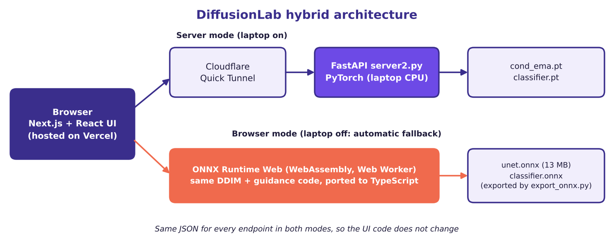](results/arch_hybrid.png)

- **Frontend:** Next.js and React on Vercel.
- **Server mode (laptop on):** FastAPI (`server2.py`) loads the PyTorch checkpoints and answers REST requests, reached through a Cloudflare Quick Tunnel. Fastest option.
- **Browser mode (laptop off):** `export_onnx.py` exports the models to ONNX (`frontend/public/models/`). ONNX Runtime Web runs them with WebAssembly inside a Web Worker, and the DDIM loop, guidance and all eleven endpoints are ported to TypeScript (`frontend/src/lib/engine/`).
- **Automatic switch:** on start-up the page asks the server for `/api/info` (4-second time-out). If it answers, requests go to the server; otherwise they run in the browser. If the server disappears mid-session, the next request falls back to the browser.
- **Same JSON in both modes**, so the UI code does not care where the answer came from. The same seed gives different images in the two modes, because the browser cannot reproduce PyTorch's random numbers.

---

## DiffusionLab Frontend (Next.js)

DiffusionLab is an interactive web application built using Next.js and React. It provides an interface for exploring the trained class-conditional diffusion model and understanding its generation process.

The application has eight modules, grouped in the sidebar into **Create**, **Explore**, **Evaluate** and **History** (a dropdown menu on phones).

### 1. Generation Studio

- Generate multiple handwritten digits using selected class labels.
- Configure classifier-free guidance strength, DDIM sampling steps, and random seed.
- View generated images alongside classifier predictions and confidence scores.
- Download individual images or the complete generation batch.

### 2. Denoising Visualizer

- Visualize the reverse diffusion process through intermediate sampling snapshots.
- Play, pause, and replay the denoising sequence.
- Adjust playback speed and navigate through the sampling timeline.
- Observe how random noise gradually develops into recognizable digits.

### 3. Noise Interpolation

- Generate transitions between two different noise inputs.
- Explore intermediate images along the interpolation path.
- Navigate through generated interpolation frames.
- Observe how changes in initial noise influence the final output.

### 4. Experiment Lab

- Run controlled experiments with different guidance strengths, sampling steps, and random seeds.
- Compare generated outputs and quantitative metrics.
- View experiment results through charts and recommendations.
- Export experiment results as CSV files.
- Save experiment configurations for future comparison.

### 5. Experiment History

- Store previous experiment records using browser-based IndexedDB storage.
- Review saved experiment configurations and results.
- Reuse previous settings without manually entering parameters again.
- History is stored locally in the browser; no user account or server-side database is required.

### 6. Representation Explorer

- Inspect internal feature maps generated by the U-Net bottleneck.
- Explore the model's 256 bottleneck channels.
- Select individual channels and visualize their activation patterns.
- Use Feature Evolution to examine how selected channel activations change across different diffusion timesteps.

The Representation Explorer visualizes internal U-Net activations. It is not a VAE latent-space visualization.

### 7. Recognition Timeline

- At every DDIM step the sampler makes a guess of the final clean image; the CNN classifier reads that guess.
- A line chart shows the probability of the requested digit at each step, for up to four guidance scales from the same starting noise.
- Reports the step from which at least 90% of samples stay on the requested digit, or that they never settle.
- Hover for exact values, or show the data as a table.

### 8. Sketch to Digit

- Draw a digit on a canvas; it is centred and resized like MNIST.
- The model adds noise up to a chosen step (edit strength) and then denoises it (SDEdit).
- Pick a target digit (uses guidance) or let the model decide.
- Low strength keeps your shape; high strength lets the model redraw it.

### 9. 2D Playground

- The full algorithm on 2-D points instead of images: 100 steps, an MLP (`3 → 128 → 128 → 2`, input `x, y, t/T`) in place of the U-Net.
- Scrub the timestep slider in either direction, or play the forward (noising) or reverse (denoising) process.
- Three shapes: swiss roll, two moons, and 8 Gaussians (a mode-coverage test, like the 10 MNIST digits).
- Four trained schedules per shape (gentle, linear, aggressive, cosine) with a plot of how much signal each keeps at every step.
- Three samplers: DDPM with all 100 steps, or deterministic DDIM with 20 or 10 model calls from the same starting noise.
- The MLP runs in plain TypeScript on the page (no server, no ONNX runtime). Each shape's 4 models are one 390 KB JSON file written by `toy2d.py`, loaded when the shape is first picked.

---

### Local Development

The frontend and backend run as separate applications during local development.

**Start the FastAPI backend** from the project root:

```bash
python -m uvicorn server2:app --host 127.0.0.1 --port 8000
```

**Start the Next.js frontend** in a second terminal:

```bash
cd frontend
npm install
npm run dev
```

Open the frontend at:

`http://localhost:3000`

`npm install` also copies the ONNX Runtime Web files into `frontend/public/ort` (see `frontend/scripts/copy-ort.mjs`). To test browser mode locally, simply do not start the backend: the badge at the top shows **Running in your browser**.

The backend Swagger UI is available at:

`http://127.0.0.1:8000/docs`

---

## API Documentation

The FastAPI backend exposes REST endpoints for model inference, generation experiments, visualization, and evaluation.

Interactive API documentation is available through Swagger UI at:

`http://127.0.0.1:8000/docs`

### Available Endpoints

| Method | Endpoint | Description |
|---|---|---|
| GET | `/api/info` | Returns backend status and model information. |
| POST | `/api/generate` | Generates class-conditional handwritten digits. |
| POST | `/api/compare` | Compares generation results across different guidance settings. |
| POST | `/api/experiment` | Runs configurable generation experiments and returns evaluation metrics. |
| POST | `/api/interpolate` | Generates interpolated samples between noise inputs. |
| POST | `/api/visualize` | Returns intermediate denoising snapshots for visualization. |
| POST | `/api/representation` | Extracts and returns internal U-Net bottleneck representations. |
| POST | `/api/representation/evolution` | Tracks selected feature-channel activations across timesteps. |
| POST | `/api/evaluate` | Evaluates generated samples using the trained classifier. |
| POST | `/api/recognition` | Classifier reading of the clean-image guess at every sampling step. |
| POST | `/api/sketch` | Sketch to digit (SDEdit) with classifier verdicts. |

The backend loads the trained conditional diffusion model and evaluation classifier from the `checkpoints/` directory. The same eleven endpoints are implemented in the browser engine (`frontend/src/lib/engine/localApi.ts`) and return the same JSON.

---

## Automated Testing

The backend API is tested using **Pytest** and **HTTPX**.

The API test suite is located in `tests/test_api.py`. Two smaller suites need no server: `tests/test_schedule.py` (linear and cosine schedule option, checkpoint names) and `tests/test_toy2d.py` (2D playground script).

### Test Coverage

- Backend health and model information.
- Class-conditional image generation.
- Guidance comparison.
- Experiment execution.
- Noise interpolation.
- Denoising visualization.
- U-Net representation extraction.
- Feature evolution across timesteps.
- Generated image evaluation.
- Recognition timeline.
- Sketch to digit, with and without a target digit.
- Invalid input handling: digit 10 (status 422) and an empty sketch canvas (status 400).

### Running Tests

From the project root, with the virtual environment activated:

```bash
pytest -v tests/test_api.py
```

### Test Results

- **Total tests:** 14
- **Passed:** 14 (local backend with the trained model, 26 November 2026; again with the cosine model on a 2-core test machine, 28 November 2026)
- **Failed:** 0
- `tests/test_schedule.py` and `tests/test_toy2d.py`: 11 of 11 passed (28 November 2026)

The first ten tests passed in 8.62 s; the four newer ones cover the recognition and sketch endpoints. The tests send HTTP requests to a running FastAPI server, so start the backend first (otherwise every test fails with `ConnectError`). The browser engine and the frontend are not covered by these tests; they were checked by hand and with scripted browser runs (Results section 15).

---

## Results

All numbers below are for **32x32 images, `BASE_CH = 64`, 30 epochs, trained on a Colab T4**, unless stated otherwise. **Sections 1 to 15 use the original linear-schedule model.** Section 17 compares it with the cosine-schedule model, which the site now uses; set `DIFFUSION_SCHEDULE=linear` to reproduce the earlier sections.

### 1. Data and Forward Process

Images are normalized to `[-1, 1]` so they live on the same scale as the unit-variance noise. With `T = 400` and a linear schedule from `1e-4` to `0.02`, `alpha_bar` goes from `0.9999` to `0.0175`, so the last step is almost pure static.

Training set counts per digit (0 to 9): 5923, 6742, 5958, 6131, 5842, 5421, 5918, 6265, 5851, 5949.

[](results/step2_forward.png)

### 2. Reverse Process (Static to Digit)

Four samples at `t = 399, 300, 200, 100, 50, 0`.

[](results/reverse_strip_ema.png)

### 3. Training

About 59 to 61 s per epoch on the T4.

| Model | Final loss |
|---|---:|
| Unconditional | 0.0243 |
| Conditional | 0.0239 (epoch 0: 0.0779) |

**Conditional model loss**

[](results/cond_loss_curve.png)

The unconditional loss curve file was lost when the Colab runtime reset, so only its final loss is reported.

### 4. EMA vs No EMA

Same starting noise, EMA decay `0.995`. On MNIST the difference is small.

[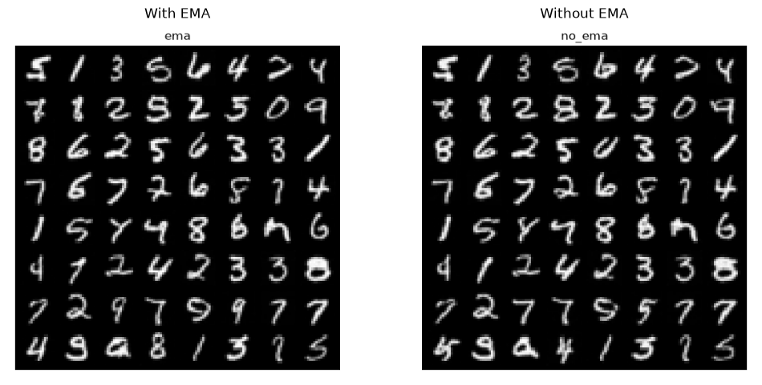](results/ema_comparison.png)

### 5. DDPM vs DDIM

64 images on a Colab T4, same starting noise.

| Sampler | Steps | Time | Speedup |
|---|---:|---:|---:|
| DDPM | 400 | 5.6 s | 1x |
| DDIM | 50 | 1.1 s | ~5x |
| DDIM | 20 | 0.7 s | ~8x |
| DDIM | 10 | 0.5 s | ~11x |

The first DDPM run took 6.8 s because it includes GPU warm-up, so 5.6 s (second run) is used as the baseline. The speedup on GPU is smaller than on CPU; I did not measure why.

DDIM is deterministic, while DDPM adds fresh noise at every step, so its grid differs.

At 32x32 the DDIM 10, 20 and 50 step grids show nearly the same digits in the same positions, with small differences in fine detail (visual impression, not measured).

[](results/ddim_comparison.png)

### 6. Class-Conditional Generation and Guidance

The label embedding is added to the time embedding. During training the label is dropped 10% of the time, so one model learns both conditional and unconditional prediction. At sampling time, guidance strength `w` mixes the two:

```python
eps = eps_uncond + w * (eps_cond - eps_uncond)
```

Each row is one digit (0 to 9). Samples use DDIM with 50 steps.

**w = 1.0**

[](results/cond_samples_w1.0.png)

**w = 1.5**

[](results/cond_samples_w1.5.png)

**w = 2.0**

[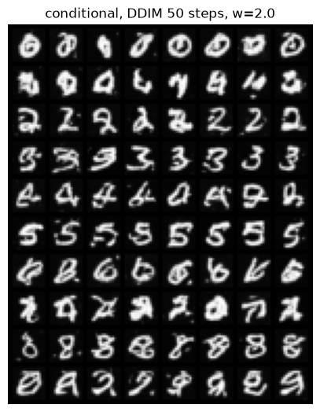](results/cond_samples_w2.0.png)

**w = 3.0**

[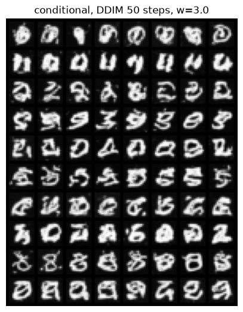](results/cond_samples_w3.0.png)

**w = 5.0**

[](results/cond_samples_w5.0.png)

**Denoising animation** (conditional model, DDIM sampling)

[](results/denoising.gif)

### 7. Evaluation

A small CNN classifier scores the generated digits. Its test accuracy is **98.52%** on the first 9,984 of the 10,000 real 32x32 MNIST test images (the data loader drops the last 16).

**Unconditional model** (1000 samples, DDIM 50 steps)

| Metric | Result |
|---|---:|
| Samples with classifier confidence > 0.9 | 74.4% |
| Predicted class counts (digits 0 to 9) | 154, 32, 153, 128, 67, 94, 81, 92, 94, 105 |

**Conditional model** (100 samples per label, DDIM 50 steps, same starting noise for every `w`)

| Guidance `w` | Label accuracy |
|---:|---:|
| 0.0 | 8.6% |
| 0.5 | 42.5% |
| 0.8 | 74.1% |
| 1.0 | 86.8% |
| **1.1** | **90.4%** |
| 1.2 | 89.8% |
| 1.3 | 85.7% |
| 1.5 | 68.2% |
| 2.0 | 29.9% |

[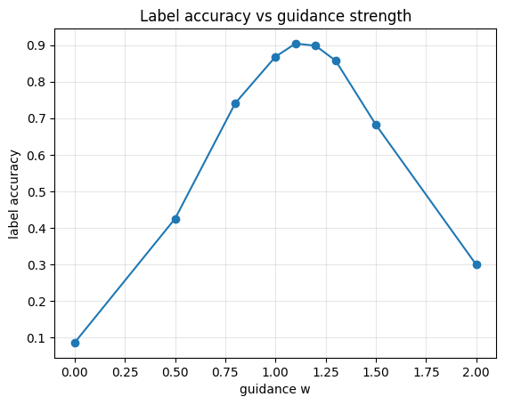](results/w_sweep.png)

`evaluate.py` gave similar numbers in a separate run: `w = 0`: 9.7%, `w = 1.0`: 86.3%, `w = 1.5`: 67.6%, `w = 2.0`: 30.0%, `w = 3.0`: 2.3%.

**Findings**

- **`w = 0` ignores the label**, so accuracy is at chance level (about 10%), as expected.
- **Guidance helps a little, and only in a narrow range.** In the single sweep, accuracy peaks around `w = 1.1` to `1.2` (about 90%) versus 86.8% at `w = 1.0`. I repeated the comparison on three more seeds (`guidance_seeds.py`, 100 samples per digit, same starting noise for every `w`; run twice, results in `results/guidance_seeds_run1.json` and `results/guidance_seeds.json`). Mean label accuracy: `w = 1.0` 88.0%, `w = 1.1` 91.1%, `w = 1.2` 91.6%, `w = 1.3` 86.4%. `w = 1.1` and `w = 1.2` beat `w = 1.0` on every seed (+3.1 and +3.5 points on average), but `w = 1.2` beat `w = 1.1` by only 0.3 to 0.6 points, so I cannot separate them with three seeds. `w = 1.3` was already below `w = 1.0` on every seed. Only three seeds and one classifier were used, so I make no significance claim. Above `w = 1.5` accuracy falls fast.
- **A wrong first conclusion.** My first sweep only tried `w = 1, 3, 5`, and I wrongly concluded that guidance does not help. A finer sweep showed the real peak.
- **Guidance numbers are for DDIM 50 steps.** I made no accuracy measurement for other step counts.

### 8. Earlier Local FastAPI Demo Speed (Laptop CPU, 32x32)

These measurements were recorded during earlier local demo sessions. They are historical measurements, not a benchmark of the current public deployment.

Measured on the laptop CPU, approximate: the "Done in" time reported by the FastAPI server for digit 7, DDIM 20 steps, seed 0. The `w = 1.2` run used 8 samples; I did not record the sample count for the other two runs.

| Guidance `w` | FastAPI server time |
|---:|---:|
| 0 | 4.2 s |
| 1.2 | 4.6 s |
| 2 | 4.32 s |

A stopwatch in the Gradio demo gave about 4.9 s for 20 steps and about 12 s for 50 steps (the number of images in that run was not recorded). In a later session the second web demo showed 2.07 s for Generate and 6.08 s for Compare (three sets of 8); I did not investigate why the times differ between sessions. For `w` other than 1.0 the model runs twice per step (conditional and unconditional), so `w` barely changes the time.

### 9. Diagnosis of Two Open Questions (`diagnose.py`)

`diagnose.py` (laptop CPU, about 15 to 18 minutes, 500 unconditional samples and 50 samples per label, DDIM 50 steps, seed 0) looks at the two open questions. These are observations from one run, not proven causes.

**Digit 1 is rare in unconditional samples.** (Update: with the cosine schedule this rose to 31 of 500, see section 17.) Only 14 of 500 samples (2.8%) were classified as 1 (earlier run: 32 of 1000). The classifier does not seem to be the cause: it is 99.74% accurate on real 1s, reads generated 1s with mean confidence 0.997, and no sample had p(1) > 0.2 while being assigned to another class. The conditional model can make 1s when asked (42 of 50 recognised at `w = 1.2`, the lowest per-digit accuracy). So the shortfall seems to come from the unconditional generator; I do not know why. Digits 0, 2 and 3 appeared most often and digits 1, 4 and 6 least often in both runs. The training set does not explain it either: digit 1 is the most frequent class in MNIST (6742 of 60,000 training images, versus 5421 to 6265 for the other digits).

**`w = 3.0` is below chance.** 17 of 500 samples (3.4%) matched the requested label. No sample was classified as 1 for any label, and the most predicted classes were 2 (118) and 0 (92). The classifier stays fairly confident (mean 0.832) and pixels are not saturated, so the images are not simply blown out. Visually, the `w = 3.0` samples are distorted blobs and tangled strokes rather than recognisable digits (see the `w = 3.0` grid above). I did not find out why guidance this strong moves samples away from the requested digit.

[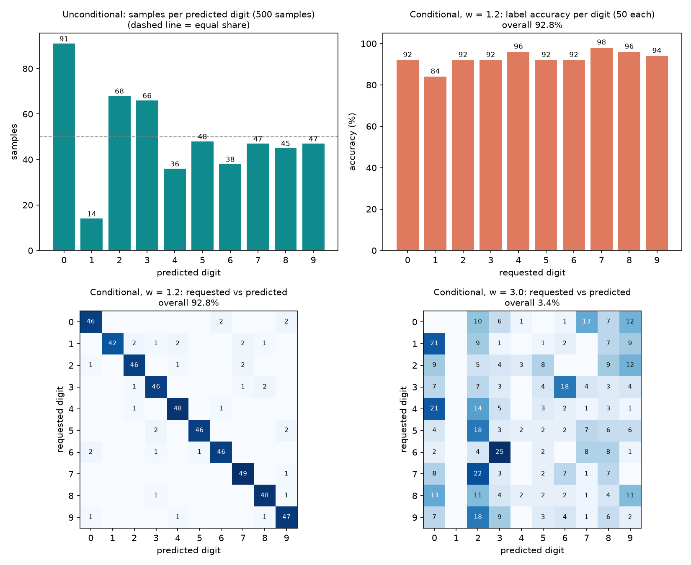](results/diagnose_plots.png)

### 10. VAE Baseline

A small VAE (`vae.py`, 10 epochs on the laptop CPU, latent size 32, untuned) was scored by the same classifier on 1000 samples and compared with the unconditional diffusion model (1000 samples, DDIM 50 steps).

| Measure | VAE | Diffusion |
|---|---:|---:|
| Samples with classifier confidence > 0.9 | 39.7% | 74.4% |
| Predicted class counts (digits 0 to 9) | 70, 81, 101, 159, 61, 70, 66, 127, 86, 179 | 154, 32, 153, 128, 67, 94, 81, 92, 94, 105 |
| Time for 64 images | 0.019 s (laptop CPU) | 1.1 s (DDIM 50, T4 GPU) |

[](results/vae_samples.png)

The classifier is more confident about the diffusion samples. The VAE is far faster per image, but the times come from different hardware, so I do not claim a speedup ratio. The VAE is small and untuned, only one seed was used, and classifier confidence is a rough measure, not FID. The VAE produced digit 1 more often (81 of 1000) than the diffusion model (32 of 1000), so the rare 1s do not seem to be a general property of generative models; the cause is still unknown.

### 11. Check for Copying of Training Images

`nn_check.py` generates 100 digits (10 per digit, `w = 1.2`, DDIM 50 steps) and finds the nearest of the 60,000 training images for each, using pixel-wise Euclidean distance. As a reference, the same distance is computed for 100 real test images.

| Measure | Generated | Real test images |
|---|---:|---:|
| Median distance to the nearest training image | 10.59 | 7.74 |
| Smallest distance | 3.10 | 1.93 |
| Generated images closer to a training image than the closest test image is | 0 of 100 | not applicable |

[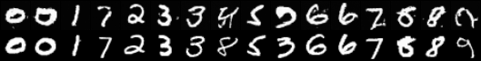](results/nn_check.png)

Top row: generated digits. Bottom row: the nearest training image of each. There is no sign that the model copies training images. This does not prove that the digits are good new samples: only 100 samples, one model and one `w` were checked, and pixel distance is a crude measure.

### 12. Earlier Hosted Frontend Demo Snapshot (Historical)

The following screenshots and measurements were captured during an earlier hosted demo. They are historical results and do not indicate that the backend is currently hosted on Modal or continuously available.

Settings for all three runs: digit 7, DDIM 20 steps, seed 42, 4 samples, guidance 1.2 (the comparison uses `w` = 0, 1.2 and 2). I did not control whether the backend was already awake, and each number is a single run.

| Run | Result |
|---|---|
| Studio, Generate | 4 of 4 samples read as 7 (confidence 99.8%, 99.6%, 99.9%, 93.9%); inference time 1.67 s |
| Compare, `w = 0` | 0 of 4 (read as 2, 3, 8, 0) |
| Compare, `w = 1.2` | 4 of 4 |
| Compare, `w = 2` | 0 of 4 (read as 1, 3, 8, 0); total Compare time 5.04 s |
| Evaluation tab | class consistency 100%, mean confidence 98.32%, diversity score 0.2706 (mean pairwise pixel L1 distance), pixel variation 0.2397, 1.72 s, 2.32 images per second |

[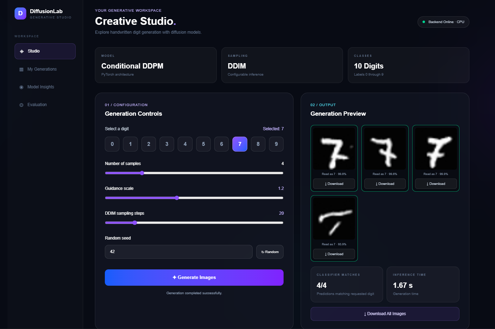](results/frontend_studio.png)

[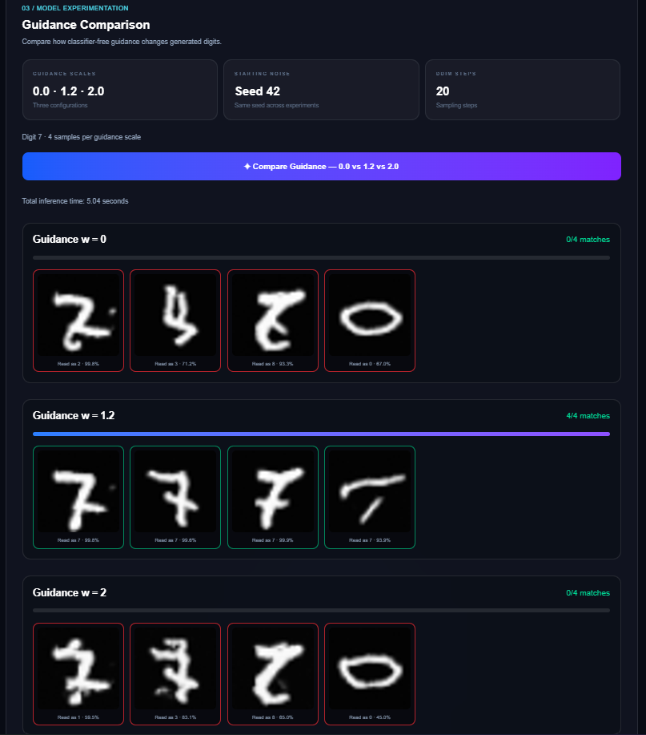](results/frontend_compare.png)

[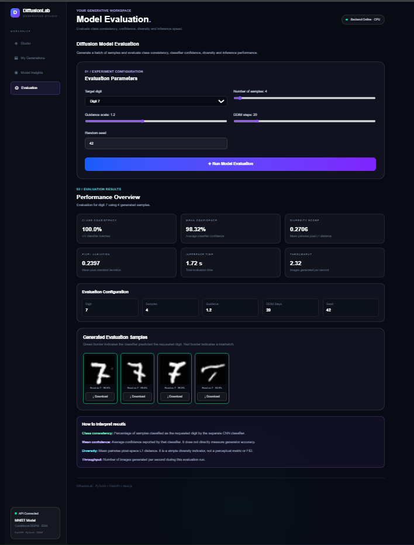](results/frontend_evaluation.png)

These are runs with only 4 samples. They show the same behaviour as the guidance results in section 7 (`w = 0` and `w = 2` mostly miss the digit, `w = 1.2` hits it) but they are not additional evidence. The diversity score is a simple indicator, not a perceptual metric or FID.

### 13. Recognition Timeline

Digit 7, DDIM 30 steps, 8 samples per run, guidance 0, 1.2 and 3.0, seeds 7, 42 and 123 (each seed gives the same starting noise to all three guidance scales), trained model on the CPU.

[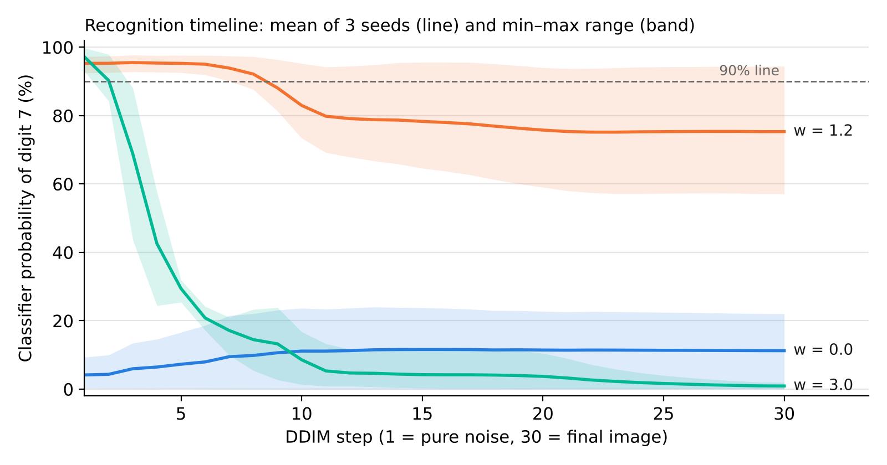](results/recognition_timeline.png)

| Seed | `w` | Step 1 | Peak | Step 30 | Final correct | Stays ≥ 90% from step |
|---:|---:|---:|---:|---:|---:|---:|
| 7 | 0.0 | 9% | 24% | 22% | 2 of 8 | never |
| 42 | 0.0 | 3% | 12% | 12% | 1 of 8 | never |
| 123 | 0.0 | 0% | 0% | 0% | 0 of 8 | never |
| 7 | 1.2 | 97% | 98% | 94% | 8 of 8 | 1 |
| 42 | 1.2 | 96% | 96% | 74% | 6 of 8 | never |
| 123 | 1.2 | 92% | 93% | 57% | 5 of 8 | never |
| 7 | 3.0 | 93% | 93% | 2% | 0 of 8 | never |
| 42 | 3.0 | 100% | 100% | 0% | 0 of 8 | never |
| 123 | 3.0 | 99% | 99% | 1% | 0 of 8 | never |

- **A high early value is not a clear digit.** With guidance, the very first guess (made from pure noise) is a blurry average digit, and the classifier already reads it as a 7 with 92% to 100% probability.
- **`w = 3.0` fails early.** The probability drops from about 97% to below 30% by step 5 and below 10% by step 10, and 0 of 24 final samples are 7s. This shows *when* the failure from section 9 happens (the first, high-noise third of sampling), not *why*.
- **`w = 1.2`** stays high for about eight steps, then settles between 57% and 94% depending on the seed (19 of 24 correct). This is lower than section 7, but the settings differ (one digit, 30 steps, 24 samples), so the numbers are not comparable.
- Only one digit, three seeds and a small classifier were used.

### 14. Sketch to Digit

One sketch of a 7 at edit strengths 0.3, 0.6 and 0.9 (target 7, `w = 1.2`, 50 full steps, seed 42). Columns: processed sketch, noised start, four results.

[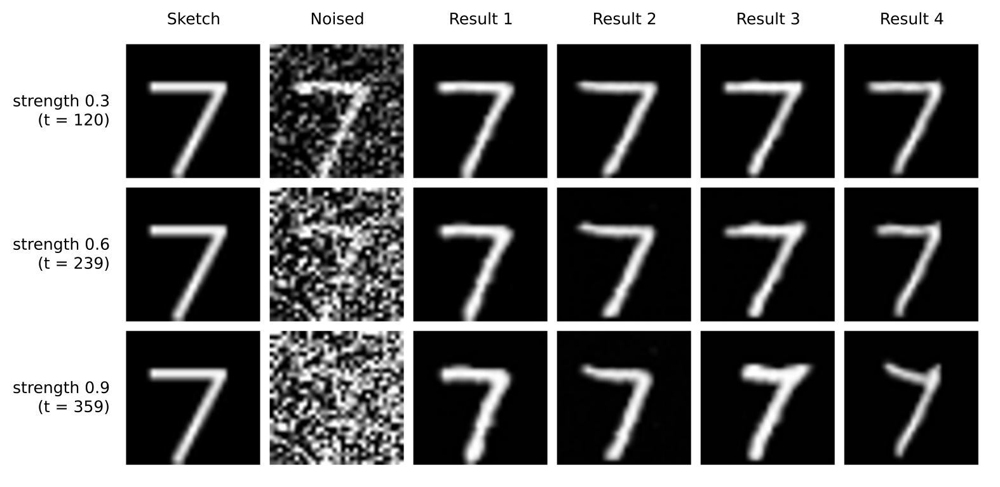](results/sketch_to_digit.png)

All 12 results, and 4 more with the digit left to the model, were read as 7 with more than 99% confidence. A mouse-drawn 7 on the laptop gave 4 of 4 correct in 1.64 s. These are single examples, not a systematic evaluation.

### 15. Browser Mode: Correctness and Speed

| Check | Setting | Result |
|---|---|---|
| ONNX export against PyTorch | 3 inputs, `t` = 0, 150, 399 | Largest difference 1.9e-6 (U-Net), 3.3e-6 (bottleneck), 3.8e-6 (classifier) |
| Full sampling, browser against PyTorch | 8 images of digit 7, 20 steps, `w = 1.2`, same starting noise | Linear model: largest pixel difference 8.4e-5; 7 of 8 read as 7 |
| Same, cosine model (Node.js, `sampler.ts` with ONNX Runtime Web, seed 42) | as above | Largest pixel difference 1.6e-3 (1.6e-5 for the linear model in the same harness); 7 of 8 read as 7, same predictions as PyTorch |
| All modules in browser mode | Every tab run once, no server | All ran without error |
| Fallback | Server stopped during a session | Next request ran in the browser |
| Speed, 2-core test machine | 8 images, 20 steps | PyTorch 2.4 s; browser 9.3 s (2 threads), 14.5 s (1 thread) |
| Responsiveness | Same run, with and without the Web Worker | 60 frames per second with the worker, 0.7 without |
| Speed, author's laptop | 4 images, 20 steps, browser mode | 2.8 s (single run) |

The browser engine is about four times slower than PyTorch on the same CPU, so browser mode starts with lighter defaults (4 images, 20 steps). Phones were not measured. The first visit downloads about 25 MB (model and runtime).

### 16. 2D Playground: Schedules, Shapes and DDIM

`python toy2d.py`: 2,000 points per shape, `T = 100`, MLP `3 → 128 → 128 → 2`, Adam 1e-3 with cosine decay, 30,000 full-batch steps (about 70 s per model, 12 models, on a 2-core CPU). Linear schedules start at β₁ = 1e-4 and differ only in β_T; cosine follows Nichol & Dhariwal (2021) with `s = 0.008` and β capped at 0.999. Sampling: 2,000 points, seed 1; DDIM uses the same starting noise as DDPM.

[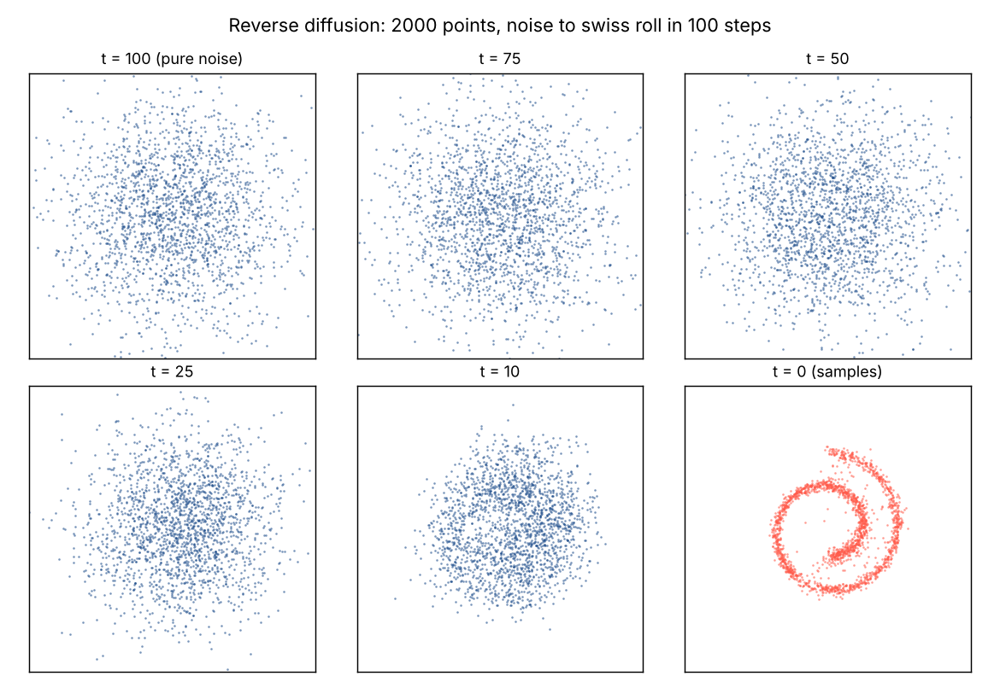](results/toy2d_reverse.png)

[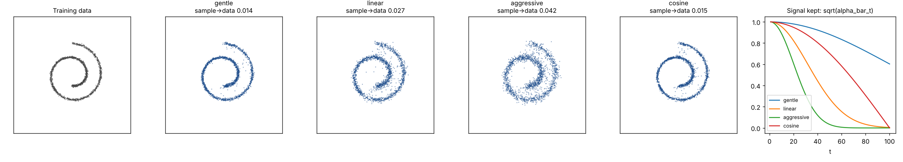](results/toy2d_schedules.png)

**Metrics.** *Sample → data* is the mean distance from each generated point to its nearest training point (lower: samples sit on the shape). *Data → sample* is the reverse (lower: the whole shape is covered). For 8 Gaussians, a mode counts as covered if at least 2% of samples land within 3σ of its centre. The last row of each table is a second real draw of 2,000 points, the best a model can score. Full numbers in `results/toy2d_metrics.json`.

**Schedules, DDPM 100 steps (sample → data / data → sample):**

| Schedule | ᾱ_T | Swiss roll | Two moons | 8 Gaussians |
|---|---|---|---|---|
| Gentle (linear, β_T = 0.02) | 0.36 | 0.014 / 0.011 | 0.018 / 0.017 | 0.017 / 0.015 |
| Linear (β_T = 0.2) | 2.1e-5 | 0.027 / 0.013 | 0.025 / 0.016 | 0.026 / 0.015 |
| Aggressive (linear, β_T = 0.5) | 4.5e-14 | 0.042 / 0.015 | 0.035 / 0.017 | 0.032 / 0.015 |
| Cosine (s = 0.008) | 2.4e-7 | 0.015 / 0.011 | 0.019 / 0.017 | 0.019 / 0.014 |
| Real vs real | | 0.011 / 0.011 | 0.016 / 0.016 | 0.015 / 0.015 |

[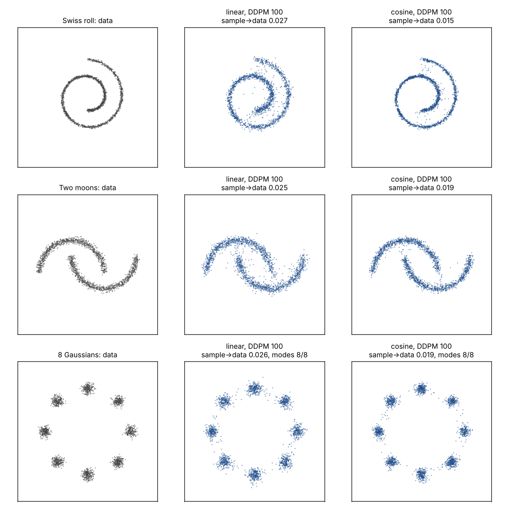](results/toy2d_shapes.png)

- **Cosine beats linear and aggressive on every shape** (sample → data 0.015 against 0.027 on the swiss roll), and it does reach pure noise.
- **Gentle still scores as well as cosine**, even though it leaves 60% of the signal at t = 100, so sampling starts from the wrong distribution. In 2-D this mismatch is small: x_T has a per-axis variance close to 1 anyway. I do not expect this to carry over to images. Gentle uses the same β range as the MNIST model, which keeps √ᾱ_T = 0.13 at t = 400.
- **Aggressive is the blurriest**: its signal is gone by about step 50, so only half the steps carry information about the shape.
- **All 8 modes were covered in every run** (all schedules and samplers). What changes is how many points fall between modes: within 3σ of a centre are 96% for cosine, 92% for linear and 89% for aggressive with DDPM (real data: 99%).
- **Training length mattered more than expected.** At 8,000 steps the linear schedule gave a visibly blurry swiss roll (sample → data 0.059); 30,000 steps brought it to 0.027. The per-timestep loss was highest at small t, where the noise is hardest to see.

**DDIM, fewer steps (sample → data):**

| Schedule | Sampler | Swiss roll | Two moons | 8 Gaussians (modes) |
|---|---|---|---|---|
| Cosine | DDPM, 100 calls | 0.015 | 0.019 | 0.019 (8/8) |
| Cosine | DDIM, 20 calls | 0.017 | 0.024 | 0.024 (8/8) |
| Cosine | DDIM, 10 calls | 0.036 | 0.028 | 0.032 (8/8) |
| Linear | DDIM, 10 calls | 0.088 | 0.055 | 0.052 (8/8) |
| Aggressive | DDIM, 10 calls | 0.154 | 0.101 | 0.111 (8/8) |

[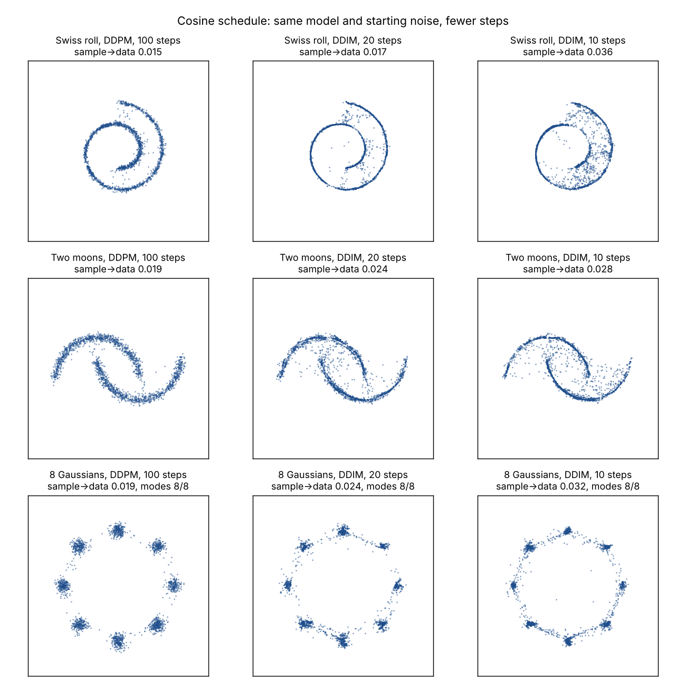](results/toy2d_ddim.png)

- **DDIM with 20 calls is close to DDPM with 100** for cosine (5× fewer model calls). At 10 calls the shapes are still recognisable, but more points land between the arms and modes.
- **The schedule matters more with fewer steps.** At 10 calls, linear is 2.4× and aggressive 4.3× worse than cosine on the swiss roll. Their signal drops fast early on, so a 10-step jump at the start skips most of the shape-forming part.
- **DDIM samples are thinner than the data** (data → sample rises, e.g. 0.011 → 0.019 on the swiss roll with 10 calls): with no fresh noise, points pile up on the middle of each arm or mode.
- **DDIM needs the x₀ clip with cosine.** At t = 100 the cosine schedule keeps √ᾱ ≈ 5e-4 of the signal, so the first x₀ estimate divides the error in ε by about 2,000. Without clipping x₀ to [-3, 3] the samples blew up (sample → data above 4 in a 300-step test run). All DDIM numbers above use the clip; DDPM does not.
- **Browser check:** after a full DDIM run (all 12 models, 20 and 10 calls, same starting noise) the largest difference in a final point is 1.6e-3; the browser keeps the schedule in float64, PyTorch in float32.

### 17. Linear vs Cosine Noise Schedule on MNIST

The 2D playground suggested that the linear schedule is a weak point: on MNIST it still keeps √ᾱ = 0.13 of the image at `t = 400`. I trained the conditional model again with the cosine schedule (Nichol & Dhariwal 2021, `s = 0.008`, β capped at 0.999, ᾱ_T = 1.5e-8) and changed nothing else: same U-Net, 32x32, `T = 400`, 30 epochs, EMA 0.995. Training and evaluation ran on a Colab T4 with `notebooks/cosine_schedule_colab.ipynb`.

Evaluation (`compare_schedules.py`): classifier label accuracy, 100 samples per digit per seed, DDIM 10, 20 and 50 steps, `w` 1.0 and 1.2, seeds 1 to 3. Every (seed, digit) starts from the same noise for both models, so each cell below is a paired comparison.

| DDIM steps | `w` | Linear | Cosine | Cosine − linear, per seed (points) |
|---|---|---|---|---|
| 10 | 1.0 | 89.8% | 90.9% | +1.1, +0.1, +1.9 |
| 10 | 1.2 | 95.4% | 96.2% | +0.5, +1.4, +0.7 |
| 20 | 1.0 | 89.0% | 92.5% | +3.2, +4.2, +3.3 |
| 20 | 1.2 | 94.1% | 97.0% | +2.3, +3.8, +2.6 |
| 50 | 1.0 | 88.0% | 93.2% | +5.5, +5.1, +4.8 |
| 50 | 1.2 | 91.6% | 96.1% | +4.8, +4.8, +4.1 |

[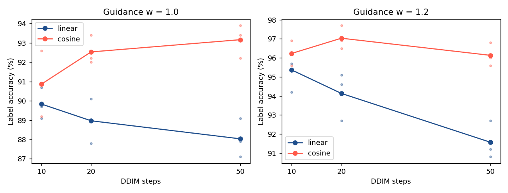](results/schedule_compare.png)

Per-digit accuracy, mean over all 18 settings above:

| Digit | 0 | 1 | 2 | 3 | 4 | 5 | 6 | 7 | 8 | 9 |
|---|---|---|---|---|---|---|---|---|---|---|
| Linear | 92.4 | 86.6 | 90.4 | 93.8 | 89.0 | 91.9 | 94.3 | 90.3 | 88.7 | 95.8 |
| Cosine | 97.4 | 91.8 | 93.7 | 95.2 | 92.5 | 93.5 | 95.6 | 94.1 | 92.3 | 97.3 |

Samples at DDIM 20, `w = 1.2`, seed 1, same noise per position (left: linear, right: cosine):

<p>
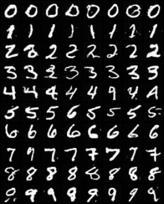
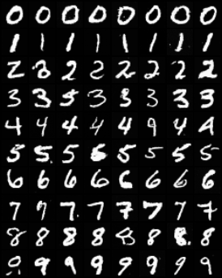
</p>

- **Cosine was more accurate in all 18 paired runs** (3 step counts × 2 guidance strengths × 3 seeds), and on every digit. The best setting moved from 95.4% (linear, 10 steps, `w = 1.2`) to 97.0% (cosine, 20 steps, `w = 1.2`).
- **The gap grows with more steps**: about +1 point at 10 steps, +3 at 20, +5 at 50. With linear, accuracy went *down* as steps went up (89.8% → 88.0% at `w = 1.0`); with cosine it went up or stayed flat. I do not know why the linear model gets worse with more DDIM steps.
- **This is the opposite of the 2D result**, where cosine helped most at 10 steps. So the 2D playground pointed at the right change, but its step-count pattern did not carry over to images.
- **Digit 1, the weakest class, gained 5.2 points** (86.6% → 91.8%), but it is still the weakest.
- **Unconditional model: more 1s, still too few.** I also trained an unconditional cosine model (notebook step 7, same settings, 30 epochs) and classified 500 samples (DDIM 50). Class counts, digits 0 to 9:

  | Digits 0–9 | 0 | 1 | 2 | 3 | 4 | 5 | 6 | 7 | 8 | 9 |
  |---|---|---|---|---|---|---|---|---|---|---|
  | Linear (`diagnose.py`, section 9) | 91 | **14** | 68 | 66 | 36 | 48 | 38 | 47 | 45 | 47 |
  | Cosine | 67 | **31** | 55 | 78 | 31 | 42 | 43 | 54 | 42 | 57 |

  Digit 1 went from 14 (2.8%) to 31 (6.2%), and the counts are more even (largest/smallest class 6.5× with linear, 2.5× with cosine). But 1 is still tied with 4 for the rarest class, while it is the most common digit in the training set (11.2%). So the schedule explains part of the shortfall, not all of it. One run per model, and the two runs did not use the same starting noise (`diagnose.py` and `compare_schedules.py uncond` draw it differently), so small differences between classes are not meaningful.
- **The pipeline reproduces earlier numbers exactly.** The linear model at DDIM 50 gave 87.9 / 87.1 / 89.1% at `w = 1.0` and 91.2 / 90.8 / 92.7% at `w = 1.2` for seeds 1 to 3: the same as `results/guidance_seeds_run1.json`, which was run on the laptop CPU.
- **Same speed**: the schedule does not change the model, so sampling time is the same (159 s for all 18 linear runs, 165 s for cosine, on the T4).

**Switched.** The server (`server2.py`) and browser mode now use the cosine model. Before switching I checked that the uploaded checkpoint reproduces the Colab run exactly on a CPU (DDIM 20, `w = 1.2`, seed 1: 96.9%, every per-digit number identical), re-exported it to ONNX (largest difference against PyTorch 1.9e-6) and ran all 14 API tests. Full browser sampling differs from PyTorch by up to 1.6e-3 per pixel, about 100 times more than for the linear model. The likely reason: at `t = 399` the cosine schedule keeps √ᾱ ≈ 1.2e-4 of the image, so the first DDIM step divides tiny ONNX-vs-PyTorch differences in ε by that number before the clip to [-1, 1]. Predictions were unchanged in the test above.

**Limits.** One training run per schedule, so run-to-run training variance is not measured; the gap could be partly luck of that run, although it is consistent across all 18 settings. One classifier, so this is label accuracy, not image quality or FID. Loss values are not compared, because the two schedules weight the timesteps differently.

### Side Note: Earlier 16x16 Runs on Laptop CPU

Before moving to Colab I trained 16x16 models (`BASE_CH = 32`) on a laptop CPU.

- About 2 min 15 s per epoch. Final loss: unconditional 0.0476, conditional 0.0457.
- Sampling 64 images on CPU: DDPM 400 steps 9.2 s, DDIM 50 steps 1.2 s, DDIM 20 steps 0.5 s, DDIM 10 steps 0.3 s.
- Classifier test accuracy 98.1%. Guidance sweep peaked at 93.7% at `w = 1.2` (89.5% at `w = 1.0`).
- The classifiers differ between 16x16 and 32x32, so I do not claim that one resolution is better than the other from these numbers.

---

## Limits and What I Do Not Claim

- No FID or other standard image-quality metric: a small classifier is used as a rough check.
- Not a production service. The PyTorch backend runs on a laptop CPU behind a temporary tunnel; when it is off, the site runs the model in the visitor's browser, which is slower on weak devices and was not measured on phones.
- No claim that diffusion beats VAEs or GANs in general; the VAE here is small and untuned.
- No significance claim for the guidance gain (3 seeds, one classifier).
- No full explanation for the rare digit 1: the cosine schedule raised it from 14 to 31 of 500 unconditional samples, but 1 is still among the rarest classes. The failure at `w = 3.0` is also unexplained (the recognition timeline only shows when it happens).
- One training run per noise schedule, so the cosine gain (section 17) does not include run-to-run training variance.
- The recognition timeline and sketch results use one digit and a few seeds or sketches.
- The public API has no login or rate limit.

---

## What Went Wrong

| Problem | What happened | Fix / lesson |
|---|---|---|
| Unsaved files | `python data.py` printed nothing because the tab had an unsaved dot, so Python ran the old stub | Check for the dot, turn on auto save |
| Code in the wrong file | Pasted `sample.py` code into `diffusion.py`, which then imported itself: `ImportError: cannot import name 'T'` | The first line (docstring) of each file tells you what it should contain |
| Nested project folder | The venv ended up one level above the project files | Moved the files up one level |
| Wrong training command | Ran `python train.py` without `--cond` by mistake | Stopped with Ctrl+C and checked `loss_history.json` (30 entries) to confirm old checkpoints were intact |
| Empty folder missing from the repo | `.gitignore` ignored `checkpoints/`, so its `.gitkeep` was never committed and training would fail on a fresh clone | Ignore only `*.pt` |
| Wrong conclusion about guidance | My first sweep used `w = 1, 3, 5` only and I concluded guidance hurts | A fine sweep showed a peak near `w = 1.1` to `1.2`; always sweep a range, not three points |
| Evaluation numbers changed between runs | The first `evaluate.py` run trained the classifier and used up random numbers, so the second run (which loaded it) sampled differently | The tables use the latest run |
| Git rebase left in progress | Used the VS Code Sync button and a rebase was left half done | Back up the folder first and avoid Sync when unsure; use the terminal |
| Colab runtime reset | The reset wiped `/content` (cloned repo and results). Weights survived only because `checkpoints/` was symlinked to Google Drive | Keep weights on Drive and back up `results/` after each step |
| Stale files mixed into results | Copying `results/` to Drive mixed old 16x16 files from `git clone` with new 32x32 files | Delete stale files first, then check sizes and timestamps (the old GIF was exactly 3,409,664 bytes) |
| Colab GPU quota | Free GPU access can run out ("usage limits") | Finish GPU work early and keep backups of weights and figures |
| Wrong virtual environment | VS Code auto-created a `.venv` without gradio, so `pip show gradio` said "not found" | Check the prompt shows `(venv)`, select the right interpreter |
| `requirements.txt` problems | It was saved as UTF-16 by a PowerShell redirect and did not list gradio although `app.py` imports it | Save as UTF-8, check every import against the file |
| Broken README layout | A missing closing code fence made the rest of the page appear inside a grey box on GitHub | Preview the README on GitHub after every structural edit |
| Screenshot saved in the wrong place | Saving from the Snipping Tool created `results/results/` and a file named `resultsweb_demo.png.png` | Type the full path in the save dialog, check names with `dir` |
| Free hosting failed | Render and Hugging Face did not work, Modal credits ran out, and other hosts need a card; free hosts without a card offer about 512 MB of RAM, too little for PyTorch | Exported the models to ONNX and run them in the browser (hybrid mode) |
| Browser engine returned empty images | ONNX Runtime Web in a Web Worker takes ownership of input buffers, so arrays passed to the classifier were left "detached" | Pass a copy of the array to the model |
| All API tests failed with `ConnectError` | The backend was not running when `pytest` started | Start `uvicorn server2:app` first, then run the tests in a second terminal |
| Commit landed on `main` | The feature branch was not created before committing, so `git push` said the branch did not exist | Create the branch afterwards (`git checkout -b ...`); the commit moves with it |
| 2D model looked blurry | With 8,000 training steps (as in the slide I started from) the linear 2D model gave a fuzzy swiss roll | 30,000 steps fixed it (0.059 → 0.027); check the samples, not only the loss |
| DDIM blew up with the cosine schedule | In the 2D playground, DDIM samples with cosine landed far off the shape: at `t = T` cosine keeps only √ᾱ ≈ 5e-4 of the signal, so the first clean-image guess multiplies any error by about 2,000 | Clip the clean-image guess, as the MNIST sampler already did (to [-1, 1]); the 2D sampler clips to [-3, 3] |
| Command run in the wrong folder | `cd ..` from the project root moved to `Downloads`, so `git` said "not a git repository" | Run `git status` first; the prompt path shows where you are |
| Gradio share link failed | The tunnel client download was blocked by the antivirus (found only because `Get-FileHash` reported a virus warning) | Add a folder exception for that one folder, check the hash against Gradio's checksum, remove it later |

---

## Project Structure

```text
diffusion-mnist/
│
├── config.py                  # Hyperparameters and configuration
├── data.py                    # MNIST data loading and preprocessing
├── diffusion.py               # Noise schedule, forward process, DDPM and DDIM
├── model.py                   # U-Net architecture with timestep embeddings
├── train.py                   # Model training, EMA and overfit checks
├── vae.py                     # VAE baseline
│
├── sample.py                  # Unconditional DDPM/DDIM sampling
├── sample_cond.py             # Class-conditional sampling with guidance
├── evaluate.py                # Classifier-based evaluation
├── sweep_w.py                 # Classifier-free guidance sweep
├── make_gif.py                # Denoising process GIF generation
├── app.py                     # Gradio demo
│
├── server2.py                 # Current FastAPI backend
├── lab_features.py            # Recognition timeline and sketch to digit
├── export_onnx.py             # Export models to ONNX for browser mode
├── toy2d.py                   # 2D diffusion (3 shapes, 4 schedules, DDIM) and playground weights
├── compare.py                 # EMA vs non-EMA comparison
├── compare_ddim.py             # DDPM vs DDIM comparison
├── check_setup.py             # Environment and setup checks
├── check_clf.py               # Classifier accuracy check
├── diagnose.py                # Per-digit diagnosis
├── plot_diagnose.py           # Diagnosis plots
├── guidance_seeds.py          # Guidance comparison across seeds
├── nn_check.py                # Nearest-neighbour copy check
├── preflight.py               # Pre-demo environment checks
├── compare_schedules.py       # Linear vs cosine schedule on the conditional model
├── notebooks/
│   └── cosine_schedule_colab.ipynb  # Train the cosine model and compare, on Colab
│
├── frontend/                   # Next.js, React and TypeScript frontend
│   ├── src/app/                # Pages and components (page.tsx, RecognitionTimeline, SketchToDigit, ...)
│   ├── src/lib/engine/         # Browser engine: ONNX Runtime Web, DDIM, endpoints
│   ├── public/models/          # unet.onnx, classifier.onnx, schedule.json
│   └── scripts/copy-ort.mjs    # Copies ONNX Runtime Web files on npm install
├── static/                     # index2.html, the page served by server2.py at /
├── results/                    # Experimental figures and outputs
├── checkpoints/                # Model checkpoints (only these three are in Git)
│   ├── cosine_cond_ema.pt      # Conditional diffusion model, cosine schedule (default)
│   ├── cond_ema.pt             # Conditional diffusion model, original linear schedule
│   └── classifier.pt           # Evaluation classifier
│
├── tests/
│   ├── test_api.py             # Automated backend API tests
│   ├── test_toy2d.py           # 2D playground script
│   └── test_schedule.py        # Linear and cosine schedule option
│
├── requirements.txt            # Python dependencies
└── README.md
```

---

## References

**Papers**

- Ho, Jain, Abbeel (2020), [Denoising Diffusion Probabilistic Models](https://arxiv.org/abs/2006.11239)
- Song, Meng, Ermon (2021), [Denoising Diffusion Implicit Models](https://arxiv.org/abs/2010.02502)
- Ho and Salimans (2022), [Classifier-Free Diffusion Guidance](https://arxiv.org/abs/2207.12598)
- Nichol and Dhariwal (2021), [Improved Denoising Diffusion Probabilistic Models](https://arxiv.org/abs/2102.09672)
- Kingma and Welling (2013), [Auto-Encoding Variational Bayes](https://arxiv.org/abs/1312.6114)
- Meng et al. (2022), [SDEdit: Guided Image Synthesis and Editing with Stochastic Differential Equations](https://arxiv.org/abs/2108.01073)

**Software**

- [ONNX Runtime Web](https://onnxruntime.ai/docs/tutorials/web/) for in-browser inference

**Dataset**

- [MNIST](https://pytorch.org/vision/stable/generated/torchvision.datasets.MNIST.html) handwritten digits, loaded through `torchvision`.