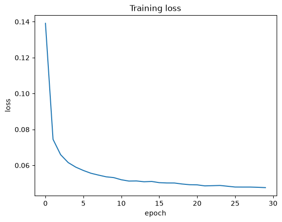
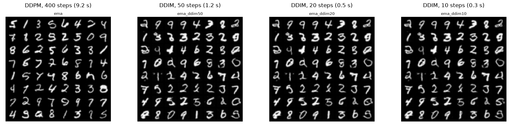
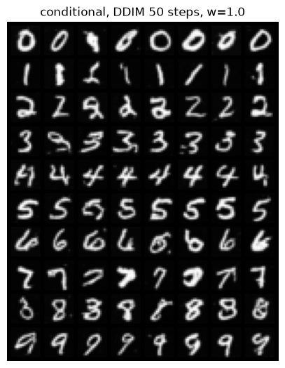
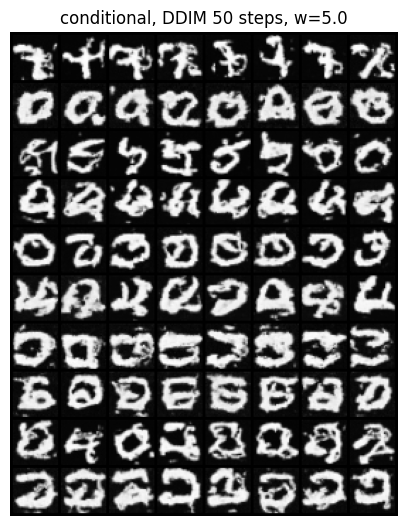

<h1 align="center">Diffusion MNIST</h1>

<p align="center">
  A DDPM-style image generator built <b>from scratch in PyTorch</b>.<br>
  It learns to remove noise, then turns pure static into brand-new handwritten digits.
</p>

<p align="center">
  
</p>

I built this to understand the core idea behind Stable Diffusion and Midjourney, scaled down to run on a laptop CPU. Everything (noise schedule, U-Net, training loop, samplers) is written by hand.

**Features**

- U-Net with sinusoidal time embeddings
- 400-step linear noise schedule
- DDPM sampler (400 steps) and DDIM sampler (10 to 50 steps)
- EMA of weights
- Class-conditional generation with classifier-free guidance
- Classifier-based evaluation of generated digits

---

## Table of contents

1. [How diffusion works](#how-diffusion-works)
2. [Setup](#setup)
3. [Usage](#usage)
4. [Results](#results)
5. [What went wrong](#what-went-wrong)
6. [Project structure](#project-structure)
7. [References](#references)

---

## How diffusion works

A diffusion model learns to undo noise. In the forward process I take a real image and add a little Gaussian noise at each of 400 steps until only static is left. This needs no learning, and a closed-form formula lets me jump to any step `t` in one operation, which makes training cheap. A U-Net is then trained to predict the noise that was added to an image, and it is told how noisy the input is through a time embedding. To generate a new image, I start from pure random noise and repeatedly remove the predicted noise, step by step, until a digit appears.

The key formula (forward process, jump straight to step `t`):

```
x_t = sqrt(alpha_bar_t) * x_0 + sqrt(1 - alpha_bar_t) * eps,    eps ~ N(0, I)
```

Training objective (predict the noise):

```
L = || eps - eps_theta(x_t, t) ||^2
```

---

## Setup

```bash
python -m venv venv

# Windows PowerShell
venv\Scripts\Activate.ps1
# Mac / Linux
# source venv/bin/activate

# Install torch and torchvision first, using the command from pytorch.org
pip install -r requirements.txt
python check_setup.py
```

Tested with Python 3.13 and PyTorch 2.15 (CPU build).

---

## Usage

| Command | What it does |
|---|---|
| `python data.py` | Check the data pipeline and save a grid of real digits |
| `python diffusion.py` | Plot the forward process (digit turning into static) |
| `python model.py` | Check U-Net shapes and that the output reacts to `t` and the label |
| `python train.py --overfit` | Sanity check: overfit a single batch of 16 images |
| `python train.py --epochs 30` | Train the unconditional model |
| `python train.py --cond --epochs 30` | Train the class-conditional model |
| `python sample.py` | Unconditional DDPM sampling (400 steps) |
| `python sample.py --ddim 50` | Unconditional DDIM sampling (50 steps) |
| `python sample_cond.py --w 1.0` | Conditional sampling, one digit per row |
| `python evaluate.py` | Classifier-based evaluation |

All settings (image size, `T`, learning rate, epochs, EMA decay) live in `config.py`.
All results below were produced on a **laptop CPU with 16x16 images**.

---

## Results

### 1. Data and forward process

Images are resized to 16x16 and normalized to `[-1, 1]` so they live on the same scale as the unit-variance noise. With `T = 400` and a linear schedule from `1e-4` to `0.02`, `alpha_bar` goes from `0.9999` to `0.0175`, so the last step is almost pure static.

<p align="center">
  
</p>

### 2. Reverse process (static to digit)

Four samples at `t = 399, 300, 200, 100, 50, 0`.

<p align="center">
  
</p>

### 3. Training

30 epochs, about 2 min 15 s per epoch on CPU. The loss drops fast, then plateaus.

| Model | Final loss |
|---|---|
| Unconditional | 0.0476 |
| Conditional | 0.0457 |

<table align="center">
  <tr>
    <td align="center"><b>Unconditional</b><br></td>
    <td align="center"><b>Conditional</b><br></td>
  </tr>
</table>

### 4. EMA vs no EMA

Same starting noise, EMA decay `0.995`. On MNIST the difference is small: EMA samples look slightly smoother, but both are close.

<p align="center">
  
</p>

### 5. DDPM vs DDIM

64 images on CPU, same starting noise.

| Sampler | Steps | Time | Speedup |
|---|---|---|---|
| DDPM | 400 | 9.2 s | 1x |
| DDIM | 50 | 1.2 s | ~8x |
| DDIM | 20 | 0.5 s | ~18x |
| DDIM | 10 | 0.3 s | ~30x |

DDIM is deterministic, so with the same starting noise the 10, 20 and 50 step grids look very similar to each other. DDPM adds fresh noise at every step, so its grid differs.

<p align="center">
  
</p>

### 6. Class-conditional generation and guidance

The label embedding is added to the time embedding. During training the label is dropped 10% of the time, so one model learns both conditional and unconditional prediction. At sampling time, guidance strength `w` mixes the two:

```
eps = eps_uncond + w * (eps_cond - eps_uncond)
```

Each row is one digit (0 to 9). Samples use DDIM with 50 steps.

<table align="center">
  <tr>
    <td align="center"><b>w = 1.0</b><br></td>
    <td align="center"><b>w = 1.5</b><br></td>
    <td align="center"><b>w = 2.0</b><br></td>
  </tr>
  <tr>
    <td align="center"><b>w = 3.0</b><br></td>
    <td align="center"><b>w = 5.0</b><br></td>
    <td></td>
  </tr>
</table>

### 7. Evaluation

A small CNN classifier (**98.1%** test accuracy on real MNIST) scores the generated digits.

**Unconditional model** (1000 samples, DDIM 50 steps)

| Metric | Result |
|---|---|
| Samples with classifier confidence > 0.9 | 78% |
| Predicted class counts (digits 0 to 9) | 136, 46, 124, 135, 85, 124, 82, 77, 123, 68 |

**Conditional model** (1000 samples, 100 per label, DDIM 50 steps)

| Guidance `w` | Label accuracy |
|---|---|
| 0.0 | 9.9% |
| **1.0** | **90.8%** |
| 1.5 | 82.1% |
| 2.0 | 51.3% |
| 3.0 | 22.5% |
| 5.0 | 7.6% (from an earlier run) |

**Findings**

- **Class balance.** The 10 classes are roughly balanced but not perfectly: digit 1 appears only 46 times out of 1000. I did not check whether this comes from the generator or from classifier bias.
- **`w = 0` ignores the label**, so accuracy is chance level (about 10%), as expected.
- **Guidance did not help in this setup.** Accuracy was best at `w = 1.0` and fell as `w` grew, and the digits visibly break down for `w >= 2`. My guess is that the unconditional prediction is weak (small model, 30 epochs, only 10% unconditional training) and guidance amplifies its error. I have not tested this.

---

## What went wrong

| Problem | What happened | Fix / lesson |
|---|---|---|
| Unsaved files | `python data.py` printed nothing because the tab had an unsaved dot, so Python ran the old stub | Check for the dot, turn on auto save |
| Code in the wrong file | Pasted `sample.py` code into `diffusion.py`, which then imported itself: `ImportError: cannot import name 'T'` | The first line (docstring) of each file tells you what it should contain |
| Nested project folder | The venv ended up one level above the project files | Moved the files up one level |
| Wrong training command | Ran `python train.py` without `--cond` by mistake | Stopped with Ctrl+C and checked `loss_history.json` (30 entries) to confirm old checkpoints were intact |
| Empty folder missing from the repo | `.gitignore` ignored `checkpoints/`, so its `.gitkeep` was never committed and training would fail on a fresh clone | Ignore only `*.pt` |
| Wrong expectation about guidance | I expected higher `w` to improve accuracy, but it made things worse | See [Evaluation](#7-evaluation) |
| Evaluation numbers changed between runs | The first `evaluate.py` run trained the classifier and used up random numbers, so the second run (which loaded it) sampled differently | The tables use the latest run |

---

## Project structure

```
diffusion-mnist/
├── config.py           # hyperparameters
├── data.py             # MNIST loading, normalized to [-1, 1]
├── diffusion.py        # noise schedule, q_sample, DDPM and DDIM sampling
├── model.py            # time embedding + U-Net (optionally class-conditional)
├── train.py            # training loop, EMA, overfit test
├── sample.py           # unconditional sampling (DDPM / DDIM)
├── sample_cond.py      # conditional sampling with guidance
├── evaluate.py         # classifier-based evaluation
├── compare.py          # EMA vs no-EMA figure
├── compare_ddim.py     # DDPM vs DDIM figure
├── check_setup.py      # environment check
├── requirements.txt
├── notebooks/
├── results/            # figures and loss histories
└── checkpoints/        # saved weights (git-ignored)
```

---

## References

- Ho, Jain, Abbeel (2020), *Denoising Diffusion Probabilistic Models*
- Song, Meng, Ermon (2021), *Denoising Diffusion Implicit Models*
- Ho and